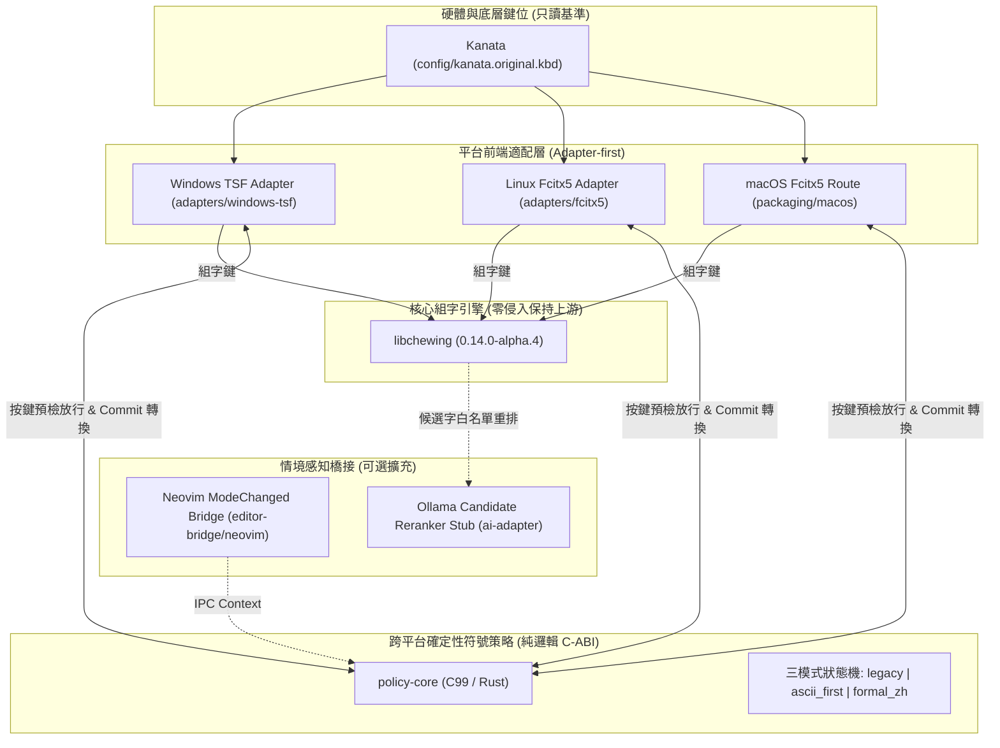

# Chewing × Kanata × Context-Aware AI IME (CKAI)
# 繁體中文／英文混合輸入法全生命週期專案

> **Windows 正式版本**：`1.1.5` ｜ **整合主線**：`main`
> **下載**：[GitHub Releases](https://github.com/edwardhome/chewing-kanata-lab/releases/latest)
> **核心準則**：保留新酷音原生注音體驗、保留使用者 Kanata 既有配置、離線優先。

Windows x64：下載並解壓正式版 ZIP，執行 `install_ime.bat`，由原使用者帳戶核准 UAC。1.1.5 將公開套件放在受保護的 `Program Files\ChewingDev`，修復開始選單／工作列搜尋的輸入法查找問題；私人詞庫與偏好仍保留在使用者目錄。安裝器不強制關閉應用，儲存工作後重新開啟測試應用，再用 Win+Space 選擇 AI新酷音。

本版另含 QWERTY F 層映射、加寬設定視窗與單行頁籤、置頂的 Restart，以及更新後的選單連結。若要解除安裝，請使用目前版本的移除器；勿用舊版安裝器直接覆蓋回退，以免留下機器層註冊。跨帳戶共用安裝尚未完成人工驗證。

以下保留早期跨平台架構規劃；不代表所有研究項目都已實作或發布。

---

## 1. 專案全貌與核心架構



---

## 2. 專案模組與目錄對照

```text
chewing-kanata-lab/
├── README.md                          # 專案總覽
├── AGENTS.md                          # 代理不可破壞行為準則 (禁止覆蓋正式輸入法/詞庫)
├── vendor-manifest.lock               # 上游版本鎖檔 (SHA、授權、建置系統)
├── BUILD_AND_RUN.md                   # 完整建置與單元測試執行手冊
├── CHANGELOG_DEV.md                   # 開發紀錄日誌
├── config/
│   ├── kanata.original.kbd            # 【唯讀基準】使用者原始 Kanata 配置
│   └── policy.example.toml            # Profile 與輸出政策配置範例
├── policy-core/                       # 跨平台純邏輯符號策略核心 (C-ABI + Rust)
│   ├── include/policy_core.h          # C 介面標頭
│   ├── src/policy_core.c              # C99 實作 (零外部依賴)
│   ├── src/lib.rs & capi.rs           # Rust 實作與 FFI
│   └── tests/test_policy.c            # 32 項單元測試 (本機 100% 通過)
├── adapters/
│   ├── windows-tsf/                   # Windows TSF 適配模組與 patch
│   └── fcitx5/                        # Linux Fcitx5 C++ 橋接與單測 (本機 100% 通過)
├── protocol/
│   ├── context_protocol.json          # Neovim Context Bridge JSON Schema
│   └── reranker_protocol.json         # Ollama 候選重排契約 JSON Schema
├── editor-bridge/neovim/              # Neovim ModeChanged Lua 外掛
├── ai-adapter/                        # Ollama 候選重排適配器與白名單驗證 (4/4 通過)
├── packaging/
│   ├── windows/                       # 隔離註冊與卸載 PowerShell 腳本 (獨立 GUID)
│   ├── linux/                         # Fcitx5 用戶個人目錄安裝腳本
│   └── macos/                         # macOS 打包規格腳本
├── ci/                                # GitHub Actions 自動化管線 (Win/Linux/macOS)
├── testdata/                          # 合成測試案例 (無私密資料)
└── docs/
    ├── source/                        # 原始輸入文件備份 (附 SHA256)
    ├── decisions/                     # ADR-0001 ~ ADR-0005 (架構決策記錄)
    ├── release/                       # 各平台安裝、卸載、回退手冊與發布狀態
    └── verification/                  # 獨立驗證目錄 (runs/ 存放真實測試日誌)
```

---

## 3. 測試驗證執行紀錄 (真實本機通過)

依據驗證分離原則，所有實測日誌均獨立存放於 `docs/verification/runs/`：
1. **Policy Core 單元測試**：[`docs/verification/runs/RUN-20261022-WIN-UNIT-01.md`](docs/verification/runs/RUN-20261022-WIN-UNIT-01.md)
   * 指令：`gcc -std=c99 -Ipolicy-core/include policy-core/src/policy_core.c policy-core/tests/test_policy.c -o test_policy.exe`
   * 結果：**32 / 32 PASS**（驗證冒號括號放行、注音保護、中文詞組保護、安全欄位、Vim 模式放行）。
2. **Fcitx5 Adapter 單元測試**：[`docs/verification/runs/RUN-20261022-FCITX5-UNIT-01.md`](docs/verification/runs/RUN-20261022-FCITX5-UNIT-01.md)
   * 指令：`g++ -std=c++11 -Ipolicy-core/include -Iadapters/fcitx5/include ... -o test_fcitx5.exe`
   * 結果：**5 / 5 PASS**（驗證 C++ 橋接層之放行與 Commit 轉換）。
3. **AI Reranker 契約測試**：[`docs/verification/runs/RUN-20261022-AI-RERANK-01.md`](docs/verification/runs/RUN-20261022-AI-RERANK-01.md)
   * 指令：`gcc -std=c99 -Iai-adapter/include ai-adapter/src/ai_reranker.c ai-adapter/tests/test_ai_reranker.c -o test_ai.exe`
   * 結果：**4 / 4 PASS**（驗證合法重排、非法幻覺 ID 攔截、重複 ID 攔截與離線降級回退）。

---

## 4. 安全回退與發布狀態

* **一鍵回退**：將設定檔設為 `default_profile = "legacy"`，行為 100% 還原為原版新酷音。
* **發布狀態**：[`docs/release/RELEASE_STATUS.md`](docs/release/RELEASE_STATUS.md)
  * Windows 11 / Linux Fcitx5：**RC-READY (Gate-A 已通過)**
  * macOS：**Pre-Alpha (腳本就緒，待實體 macOS 驗證)**

## 上游版權與致敬聲明 (Upstream Credits & Attribution)

本專案衍生自 **新酷音輸入法（Windows-Chewing-TSF）** 核心架構，並完全保留其原始核心與 GPL-3.0 開源授權協議。

* **新酷音官方儲存庫 (Upstream Repo)**: https://github.com/chewing/windows-chewing-tsf
* **開源授權聲明**: 本專案之核心衍生、修改與全新適配程式碼，皆延續採用 **GNU General Public License v3.0 (GPL-3.0-or-later)**。
* **致謝貢獻者**: 感謝新酷音開源社群及所有歷代維護者（Chewing core team & Maintainers）在中文輸入法 TSF 框架與 `libchewing` 核心的卓越貢獻，本專案在 Git 開發歷史中已完整追蹤並保留其著作權血統。

