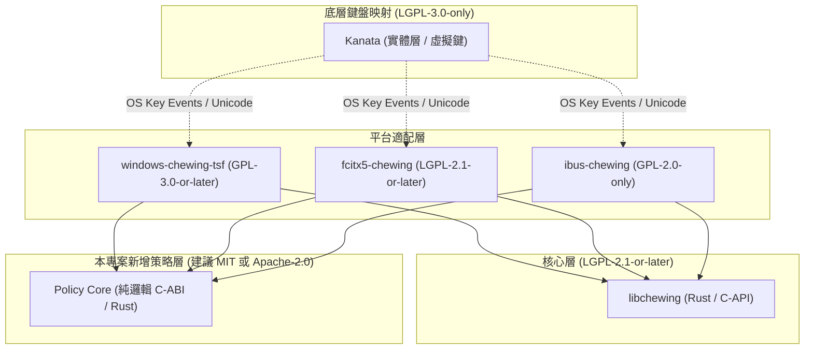

# 上游專案清單與授權稽核 (Upstream Inventory & License Audit)

> **文件狀態**：原始碼盤點與基線鎖定  
> **分支**：`research/upstream-audit`  
> **建立時間**：2026-10-22  
> **宣告**：本文件記錄實際 checkout 之上游原始碼狀態、授權條款（SPDX）、建置系統與相依關係。本階段不包含任何編譯測試或效能數據。

---

## 1. 上游儲存庫清單 (Upstream Repositories)

| 專案名稱 | 角色定位 | 主線 Remote (Codeberg 優先) | 備援 / 鏡像 (GitHub) | 實際鎖定 Commit SHA | 工作樹版本標示 | 授權 (SPDX) | 建置系統與編譯工具 |
| :--- | :--- | :--- | :--- | :--- | :--- | :--- | :--- |
| **libchewing** | 注音組字核心、詞庫、語言模型 | `https://codeberg.org/chewing/libchewing.git` | `https://github.com/chewing/libchewing` | `ec7f595ea7726fa06a9493e819b81669eba605a5` | `0.14.0-alpha.4` (Cargo) / `0.14.0-alpha.3` (CMake) | LGPL-2.1-or-later | Cargo (Rust 1.95+, Edition 2024, resolver 3) / CMake 3.27+ |
| **windows-chewing-tsf** | Windows TSF 輸入法前端服務 | `https://codeberg.org/chewing/windows-chewing-tsf.git` | `https://github.com/chewing/windows-chewing-tsf` | `053d31ba10c089ae98508dd4a908ac2c2be3cb49` | `26.9.0` (Cargo Workspace) | GPL-3.0-or-later | Cargo xtask, MSVC Build Tools 2022, Rust Edition 2024 |
| **fcitx5-chewing** | Linux Fcitx5 輸入法前端外掛 | `https://github.com/fcitx/fcitx5-chewing.git` (主線) | - | `60096e8ef49df21de6c155d7a0785a58fcccb955` | `5.1.13` (CMake) | LGPL-2.1-or-later | CMake 3.6+, ECM (Extra CMake Modules), Fcitx5Core 5.1.13 |
| **ibus-chewing** (備援) | Linux IBus 輸入法前端 | `https://codeberg.org/chewing/ibus-chewing.git` | `https://github.com/chewing/ibus-chewing` | `6e885f1a8556cb8cfcc657c5b0cfd71b93db4c5c` | `2.2.0` (Meson) | GPL-2.0-only | Meson >= 0.57.0, C23, GLib 2.0, IBus, GTK4 |
| **kanata** (配置基準) | 低階鍵盤映射層 (不可覆寫) | `https://github.com/jtroo/kanata.git` | - | 依使用者本機安裝版本為準 | 規格基準：`kanata.original.kbd` | LGPL-3.0-only | Rust |

---

## 2. 各專案詳細結構與相依關係

### 2.1 libchewing (核心)
- **目錄結構**：
  - `src/`：以現代 Rust 實作之核心組字引擎（含 `editor/`、`conversion/`、`dictionary/`、`input/`、`zhuyin/` 等模組）。
  - `capi/`：向後相容 C ABI（提供 `chewing.h`、`chewing_handle_*` 等 C 函式，由 `cbindgen` 與 FFI 導出）。
  - `data/`：詞庫與符號表子模組（`libchewing-data`）。
- **授權注意事項**：
  - 核心程式庫為 `LGPL-2.1-or-later`（見根目錄 `COPYING`）。
  - 動態連結或作為獨立共用程式庫時，不強制要求前端專案以 LGPL 釋出，但若修改 `libchewing` 本身並散佈，該修改部分必須依 LGPL 義務開放原始碼。

### 2.2 windows-chewing-tsf (Windows 前端)
- **目錄結構**：
  - `Cargo.toml`：Workspace 定義，包含以下成員：
    - `crates/chewing_tip_core`：跨行程 IPC、設定管理、更新檢查。
    - `crates/chewing_tip_host`：獨立 out-of-process 服務宿主。
    - `crates/tsfreg`：Windows COM/TSF 登錄註冊工具。
    - `tip/`：Text Input Processor 主體（實作 `ITfTextInputProcessor`、COM 元件、`chewing_editor` 整合）。
    - `xtask/`：打包與安裝器腳本。
- **相依上游**：
  - `Cargo.toml` 中宣告 `chewing = "0.14.0-alpha.4"`，且有 patch 指向 `https://codeberg.org/chewing/libchewing.git`。
- **授權注意事項**：
  - 整個 Windows TSF 專案為 `GPL-3.0-or-later`（見 `COPYING.txt`）。
  - 任何直接整合進 `tip/` 的程式碼均受 GPL-3.0 約束。

### 2.3 fcitx5-chewing (Linux 優先前端)
- **目錄結構**：
  - `src/eim.cpp`、`src/eim.h`：Fcitx5 Addon 實作，直接調用 `libchewing` C API。
  - `src/CMakeLists.txt`：連結 `Fcitx5::Core` 與 `chewing`。
  - `LICENSES/LGPL-2.1-or-later.txt`：符合 REUSE 規範的 LGPL-2.1 授權文件。
- **相依上游**：
  - 系統 `libchewing` C 函式庫（pkg-config `chewing`）。
  - Fcitx5 核心標頭檔。

### 2.4 ibus-chewing (Linux 備援前端)
- **目錄結構**：
  - `src/ibus-chewing-engine.c`：IBus 引擎實作（C 語言，GObject 模型）。
  - `meson.build`：Meson 建置組態。
- **授權注意事項**：
  - 授權為 `GPL-2.0-only`（見 `COPYING`）。

---

## 3. 授權相容性與隔離邊界矩陣

### 授權維護原則：
1. **獨立 Policy 模組**：新設計的 `policy-core` 採寬鬆授權（MIT / Apache-2.0），可同時被 GPL-3.0 (Windows TSF) 與 LGPL-2.1 (Fcitx5 / libchewing) 引用而無授權衝突。
2. **禁止授權混淆**：不可將不同專案合併為單一不明授權；所有提交與 patch 必須維持各上游原有著作權與 SPDX 標頭。
3. **隔離上游修改**：優先在平台 Adapter 端撰寫 Policy 呼叫，不強制變動 `libchewing` 核心授權邊界。
