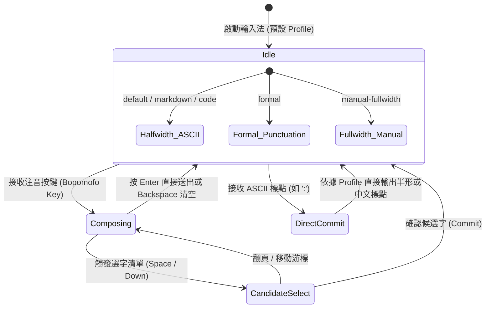

# 跨平台架構決策與最小修改方案 (Architecture Decisions)

> **文件狀態**：架構設計決策記錄 (ADR)  
> **分支**：`research/upstream-audit`  
> **建立時間**：2026-10-22  
> **核心準則**：優先既有開源架構、優先 Adapter-first、不從零開發輸入法、不先導入 AI、不變更使用者既有 Kanata 配置、保留原生新酷音回退路徑。

---

## 1. 核心工程決策總覽 (Architecture Decision Records)

### ADR-01: 優先採用 Adapter-first 策略，避免深度 Fork libchewing 核心
- **狀態**：已批准 (Approved)
- **背景**：
  在 `CODE_PATH_MAP.md` 中確認，現有 `libchewing` 核心的 `src/editor/mod.rs` 在中文模式下無條件以 `special_symbol_input` 將 ASCII 標點轉為中文全形。修改此問題有兩個技術途徑：
  - **途徑 A (Adapter-first)**：在前端（Windows TSF 與 Linux Fcitx5/IBus）攔截非注音鍵與標點符號。若當前模式為 ASCII-first (如 Markdown/Code)，且組字區無未完成拼音，直接讓前端放行 (Bypass) 或輸出 ASCII；若組字區有內容，在 commit 時經由共用 Policy 決定轉換與否。
  - **途徑 B (Core Extension)**：Fork `libchewing`，修改 `special_symbol_input`，在 `EditorOptions` 增加 `ascii_punctuation_first` 設定。
- **決策**：**第一階段優先採行途徑 A (Adapter-first)**。
- **理由**：
  1. **維護與上游同步成本最低**：`libchewing` 0.14.x 正積極重構（Rust edition 2024、resolver 3、API 變更頻繁）。若 Fork 核心，日後每次上游修復詞庫、拼音演算法時均會面臨龐大 rebase 衝突。
  2. **平台前端邏輯清晰**：Windows TSF 的 `on_keydown` (Rust) 與 Linux Fcitx5 的 `keyEvent` (C++) 本身就具備完整的按鍵預檢與放行機制（如 Windows TSF 的 `if evt.is_state_on(KeyState::Alt) return Ok(false);`）。在此處加入 Profile 判斷，改動範圍最小、影響最局部。
  3. **可隨時安全回退**：若使用者切換至原生新酷音模式，前端只需關閉 Policy 攔截，完全恢復上游原生行為。

---

### ADR-02: 保持使用者 Kanata 配置 (`kanata.original.kbd`) 為不可修改基準
- **狀態**：已批准 (Approved)
- **背景**：
  使用者已有長期穩定的肌肉記憶，包含：
  - `@capsww`: 短按 `Win+Space` 切換輸入法、連擊 Caps Lock、長按 Left Ctrl。
  - `@num`: 長按 `f` 開啟九宮格數字層與符號快捷（包含 `@ucln` `:`、`@ulb` `[`、`@u_` `_` 等）。
- **決策**：
  1. **嚴禁修改或覆寫 `kanata.original.kbd`**。
  2. 輸入法適配層必須主動適應 Kanata 發出的按鍵事件與虛擬碼，不得要求使用者修改其長按/短按延時或按鍵分佈。
  3. 新增的輸入法 Profile 切換快捷鍵（例如切換至正式中文書信模式）必須採用「可配置且預設未佔用」的獨立組合鍵，避免與 Kanata 的 `M-spc` 或常用熱鍵衝突。

---

### ADR-03: 建立輕量共用符號政策庫 (`policy-core`)
- **狀態**：已批准 (Approved)
- **背景**：
  Windows TSF (Rust) 與 Linux Fcitx5 (C++) 需要具備一致的 ASCII-first / 全形符號規則，避免兩邊平台各自硬編碼導致行為發散。
- **決策**：
  設計一個獨立的純 Rust 模組 `policy-core`，同時提供：
  - 純 Rust API (供 `windows-chewing-tsf` 直接引用為 crate)。
  - 標準 C ABI (動態函式庫或靜態函式庫，供 `fcitx5-chewing` 及 `ibus-chewing` 連結)。
  - **零系統依賴**：不調用任何 Windows API、Fcitx API 或 Ollama 網路請求，僅負責純文字轉換、Profile 狀態機與白名單查表。

```mermaid
flowchart LR
    PC["policy-core (Rust 實作)"]
    PC -->|Rust Crate 內部依賴| WTSF["windows-chewing-tsf (Rust)"]
    PC -->|C ABI (Header & Shared Lib)| F5["fcitx5-chewing (C++)"]
    PC -->|C ABI (Header & Shared Lib)| IB["ibus-chewing (C)"]
```

---

### ADR-04: 明確劃分輸入法與應用程式之權限邊界
- **狀態**：已批准 (Approved)
- **原則**：
  1. **不使用全域 Keyboard Hook (`WH_KEYBOARD_LL`)**：全域 Hook 會破壞系統安全性、引發防毒軟體警報、且極易與 Kanata 自身底層驅動衝突。
  2. **不監控/修改全域剪貼簿**。
  3. **承認應用程式後處理的邊界**：若特定應用程式（如富文本編輯器、Word 等）在接收到半形字元後自行執行「智慧標點自動轉全形」，輸入法不得試圖進行反向強制篡改，應在文件中明確告知使用者關閉應用程式的智慧符號替換選項。
  4. **保護安全輸入欄位**：在密碼欄、UAC 權限提升視窗或安全桌面中，Policy 自動退回 Passthrough，絕不快取或處理字元。

---

### ADR-05: 延後 AI (Ollama) 與 Neovim Bridge 整合，避免污染基礎輸入路徑
- **狀態**：已批准 (Approved)
- **原則**：
  1. **零雲端依賴**：第一階段完全聚焦於確定性的「字元寬度與標點政策」，不引入任何神經網路或外部服務。
  2. **後續 AI 邊界**：後續規劃之 Ollama 整合僅作為「候選字重排序 (Reranker)」，不得攔截單一按鍵，不得改寫已 Commit 文字，且推論過程需非同步執行，逾時直接捨棄。
  3. **Neovim 模式感知**：作為可選的獨立 Socket 擴充外掛，未啟動時輸入法依然依照靜態 Profile 正常運作。

---

## 2. 方案深度對比：Adapter-first vs Core Extension

| 比較維度 | 方案 A：Adapter-First 策略 (推薦) | 方案 B：libchewing Core Extension |
| :--- | :--- | :--- |
| **修改位置** | Windows TSF `chewing.rs` + Fcitx5 `eim.cpp` | `libchewing/src/editor/mod.rs` + `capi/` |
| **上游追隨難度** | **極低**：上游 libchewing 可隨時使用原始 Release | **高**：每次 libchewing 更新都需手動維護 Patch |
| **影響範圍** | 僅限於前端事件分流與 commit 字串轉換 | 牽涉 libchewing 全局符號狀態機與 C-ABI |
| **中文字詞組字相容性** | **100% 保證**：完全保留原版注音詞頻與組字 | 需極度小心避免破壞內部斷詞與詞庫查表 |
| **跨平台行為保證** | 依賴共用 `policy-core` 維持跨平台決策一致 | 核心行為原生一致，但前端仍需實作 Profile 傳遞 |
| **回退安全性** | 設定檔開關一鍵 Disable，即刻還原為原生輸入法 | 需重新編譯或切換 libchewing 函式庫 |

**綜合結論**：
本專案堅持「優先 adapter-first，除非研究能證明非改 libchewing 不可」的工程約束。現有分析證實，前端適配器已具備足夠的按鍵與提交生命週期控制權，**完全可以在 Adapter 層達成目標，無須 Fork 核心**。

---

## 3. 系統生命週期與狀態機設計



### 狀態保護原則：
1. **未完成注音組字保護**：若輸入法正在組字（`is_composing() == true`），接收到符號鍵時，優先依照使用者 Profile 處理，絕不擅自清空注音緩衝區。
2. **Esc 鍵安全處理**：按 Esc 僅取消當前組字或候選視窗，不得無故重設整個輸入法 Profile。
