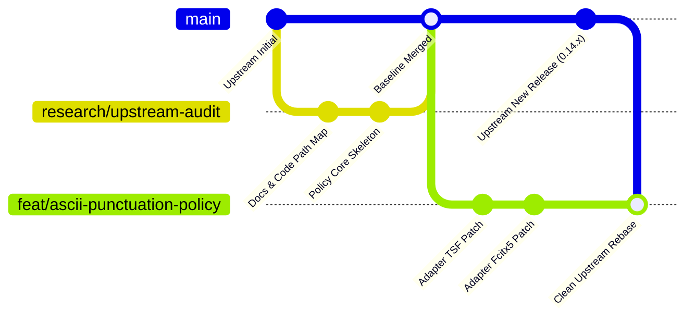

# 最小修改規劃、回退與上游維護策略 (Patch Plan & Maintenance Strategy)

> **文件狀態**：工程修改規劃草案  
> **目標原則**：小步微調、零破壞性、隔離開發、易於回退、零系統覆蓋風險。  
> **注意**：本文件為開發設計規格，不包含實際編譯結果或測試報告。

---

## 1. 最小修改範圍清單 (Target Files & Functions)

本專案採行 **Adapter-first** 策略，主要修改範圍限制在前端 Adapter，核心 `libchewing` 保持乾淨；新增獨立的 `policy-core` 策略函式庫。

### 1.1 新增模組：`policy-core` (共用策略核心)
- **路徑**：`policy-core/`
- **內容**：
  - `policy-core/src/lib.rs`：純 Rust 策略邏輯實作。
  - `policy-core/src/capi.rs`：提供給 C/C++ 呼叫之 C-ABI 介面。
  - `policy-core/include/policy_core.h`：C 標頭檔。
  - `policy-core/Cargo.toml`：宣告 `crate-type = ["lib", "cdylib", "staticlib"]`。
- **公開 API 規劃**：
  ```c
  /* policy-core/include/policy_core.h */
  typedef enum {
      POLICY_PROFILE_DEFAULT = 0,
      POLICY_PROFILE_MARKDOWN,
      POLICY_PROFILE_CODE,
      POLICY_PROFILE_FORMAL,
      POLICY_PROFILE_RAW_COMMAND,
      POLICY_PROFILE_MANUAL_FULLWIDTH
  } policy_profile_t;

  typedef struct {
      policy_profile_t current_profile;
      bool has_active_preedit;
      bool is_secure_field;
  } policy_context_t;

  /* 檢查特定 ASCII 鍵在目前 profile 下是否應直接放行給應用程式 */
  bool policy_should_bypass_key(char ascii_key, const policy_context_t *ctx);

  /* 將 commit 字串經由策略轉換 (若為 ASCII 標點且在 code/markdown profile 則保持半形) */
  const char* policy_transform_commit(const char *utf8_text, const policy_context_t *ctx);
  ```

---

### 1.2 Windows TSF 修改清單 (`windows-chewing-tsf`)

#### A. 檔案：`crates/chewing_tip_core/src/config.rs`
- **修改目的**：加入 ASCII-first 相關設定項與 Profile 支援。
- **改動點**：在 `ChewingTsfConfig` 結構體中新增欄位：
  ```rust
  pub ascii_first_mode: bool,        // 預設 true
  pub active_profile: String,         // "default", "markdown", "code", "formal"
  pub profile_hotkey: Option<String>, // 切換 Profile 之自訂熱鍵 (預設 unassigned)
  ```

#### B. 檔案：`tip/src/text_service/chewing.rs`
- **修改目的**：在按鍵進入與 Commit 節點套用 Policy。
- **函式 1**：`ChewingTextService::on_test_keydown` 與 `on_keydown`
  - **位置**：約第 480-515 行（按鍵放行過濾閘門）。
  - **邏輯**：
    ```rust
    // 當處於 ASCII-first 模式且目前無組字緩衝區時：
    // 若按下的鍵為 Markdown/程式碼關鍵符號 (如 ':', '[', ']', '{', '}', '_', '`')
    // 且未按住任何注音相關組合，直接放行給應用程式，避免被 chewing 的 special_symbol_input 吞進組字區轉成全形！
    if self.cfg.chewing_tsf.ascii_first_mode && !self.is_composing() {
        if is_ascii_first_punctuation(evt.ksym) {
            debug!("ASCII-first policy: bypass key {:?}", evt.ksym);
            return Ok(false); // 放行給 OS/應用程式
        }
    }
    ```
- **函式 2**：`ChewingTextService::insert_text` 與 `ChewingTextService::update_preedit`
  - **位置**：約第 694 行、第 715 行與第 1046 行。
  - **邏輯**：若組字區完成提交（Commit），經由 `policy-core` 驗證提交字串是否包含誤轉換之符號，依據當前 Profile 決定是否保持 ASCII。

---

### 1.3 Linux Fcitx5 修改清單 (`fcitx5-chewing`)

#### A. 檔案：`src/eim.h`
- **修改目的**：新增 Policy 實例與 Profile 設定變數。
- **改動點**：在 `ChewingEngine` 類別中新增 `policy_context_t policyContext_;` 成員與配置選項。

#### B. 檔案：`src/eim.cpp`
- **修改目的**：在按鍵分流前進行 ASCII-first 攔截，並在 commitString 前進行轉換。
- **函式 1**：`ChewingEngine::keyEvent`
  - **位置**：約第 474 行之前。
  - **邏輯**：
    ```cpp
    // 檢查無組字緩衝區時的 ASCII 符號放行
    if (config_.asciiFirstMode && chewing_buffer_Check(ctx) == 0 && chewing_bopomofo_Check(ctx) == 0) {
        if (keyEvent.key().isSimple() && !keyEvent.rawKey().states().test(KeyState::Shift)) {
            char keyChar = keyEvent.key().sym() & 0xff;
            if (is_ascii_punctuation(keyChar)) {
                // 不呼叫 chewing_handle_Default，直接放行給應用程式！
                return;
            }
        }
    }
    ```
- **函式 2**：Commit 提交點
  - **位置**：第 111 行 (`ChewingCandidateWord::select`)、第 565 行 (`keyEvent`)、第 687 行 (`flushBuffer`)。
  - **邏輯**：
    ```cpp
    auto committed = safeChewing_commit_String(ctx);
    auto finalOutput = policy_transform_commit(committed.c_str(), &policyContext_);
    ic->commitString(finalOutput);
    ```

---

## 2. 公開 API / ABI 影響評估

1. **libchewing C-API**：
   - **完全無影響**：本方案不在第一階段變更 `chewing.h` 或導出符號，保持二進位完全相容。
2. **Windows TSF COM 介面**：
   - **完全無影響**：TSF 的 COM GUID (`CLSID_ChewingTextService` 等) 保持標準規範，不變更 COM 呼叫約定。
3. **Fcitx5 Addon 介面**：
   - **完全無影響**：維持 `FCITX_ADDON_FACTORY_V2`，不改變 Fcitx5 的外掛註冊合約。

---

## 3. 系統隔離與不安裝覆蓋防護

為嚴格遵守「不得直接修改使用者現有 Kanata 配置、個人詞庫或系統正式輸入法」之要求，建立以下工程隔離措施：

### 3.1 Windows 隔離策略
1. **獨立 COM GUID 與顯示名稱**：
   - 開發版本更名為 `Chewing ASCII-First Dev (TSF)`。
   - 採用獨立的 `CLSID` 與 `ProfileID`（於 `crates/tsfreg` 與 `tip/src/text_service/mod.rs` 中定義專屬測試 GUID）。
   - 確保本專案建置之安裝器或註冊檔**絕不覆蓋**既有官方新酷音輸入法。
2. **詞庫資料夾隔離**：
   - 將使用者設定與詞庫路徑指向專屬目錄：`%APPDATA%\ChewingDev\`，而不讀寫 `%APPDATA%\Chewing\`。

### 3.2 Linux 隔離策略
1. **獨立 Addon 名稱**：
   - Fcitx5 外掛名稱命名為 `fcitx5-chewing-dev`，設定檔位於 `~/.config/fcitx5/conf/chewing-dev.conf`。
   - 安裝前綴設定為開發隔離路徑（例如 `$HOME/.local`），不使用 `sudo make install` 覆蓋系統 `/usr/lib/`。

---

## 4. 回退與上游同步策略 (Rollback & Upstream Sync)

### 4.1 一鍵軟體回退 (Runtime Fallback)
在配置檔中提供全域開關：
```toml
[general]
ascii_first_enabled = false  # 設為 false 時，所有攔截完全旁路，行為 100% 等同上游原版新酷音
```

### 4.2 Git 上游追隨與同步流程 (Upstream Tracking)



1. **遠端追踪分支**：
   - `upstream/libchewing`: `https://codeberg.org/chewing/libchewing.git`
   - `upstream/windows-chewing-tsf`: `https://codeberg.org/chewing/windows-chewing-tsf.git`
   - `upstream/fcitx5-chewing`: `https://github.com/fcitx/fcitx5-chewing.git`
2. **Patch 拆分原則**：
   - 所有的 Adapter 變動保持最小差分（Diff 小於 100 行）。
   - 當上游發布新版本時，直接透過 `git rebase` 或 `git cherry-pick` 套用 Adapter patch，零相依性負擔。
