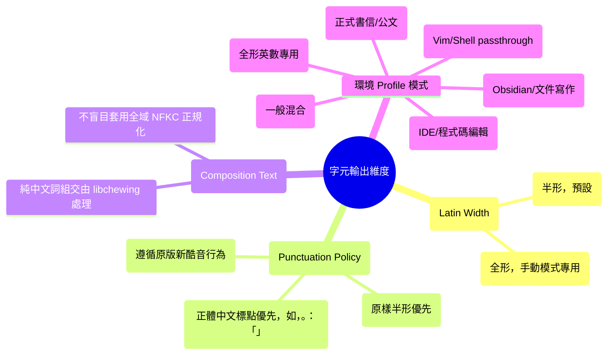

# 符號輸出政策與字元邊界規格書 (Character Output Policy Specification)

> **文件狀態**：輸出策略規格書  
> **目標**：解決「Markdown/程式碼高頻輸入需要半形 ASCII，但正式中文書信與公文仍需中文全形標點」之衝突，達成**少手動切換、不失去控制、可精準回退**之體驗。  
> **注意**：本文件為規格定義與行為準則，不含實測數據。

---

## 1. 核心原則：維度分離 (Dimensional Separation)

傳統輸入法往往將「全形／半形」簡化為單一的 Boolean 開關（Shift+Space），造成非黑即白的痛苦：開了全形，連程式碼括號冒號都變全形；開了半形，連中文句點逗點都變半形。

本專案將字元輸出維度嚴格分離為四個獨立軸度：



---

## 2. Profile 詳細規格矩陣

| Profile 名稱 | 適用場景 | ASCII 符號 (如 `:[]{}()_`) | 中文標點 (如 `，。、「」`) | 英文字母與數字 | 組字緩衝區行為 | AI 介入 |
| :--- | :--- | :--- | :--- | :--- | :--- | :--- |
| **`default`** (預設) | 一般中英混合打字、聊天 | 無組字時直接送 ASCII；組字中若為明確標點可選轉全形 | 保留中文標點功能 | 100% ASCII 半形 | 正常注音組字 | 預設關閉 |
| **`markdown`** | Obsidian、VS Code Markdown、筆記 | **強制保持 ASCII 半形** (保護 `[]()#*-` 等語法) | 手動明確選字時輸出中文全形標點 | 100% ASCII 半形 | 符號鍵不污染組字區 | 預設關閉 |
| **`code`** | VS Code、CLion、Neovim 等 IDE | **絕對 Passthrough**，絕不自動轉全形 | 僅在明確中文註解/字串組字時允許 | 100% ASCII 半形 | 符號鍵直接繞過 IME | 關閉 |
| **`formal`** | 正式電子郵件、公文、學術報告 | 可手動選用中文標點；但**強制保護** URL/Email/代碼塊 | **優先輸出繁體中文標點** (如 `，。：「」`) | 預設 ASCII (保護 Email 地址) | 支援完整標點對應 | 可選 |
| **`raw-command`** | Vim Normal / Visual 模式、Shell 命令 | **完全 Passthrough** (不經 IME) | 不介入 | 100% 原始按鍵碼 | 完全關閉組字 | 關閉 |
| **`manual-fullwidth`** | 使用者主動切換至全形輸入 | 全形符號 (如 `：〔〕（）`) | 全形中文標點 | 全形英數 (如 `ＡＢＣ１２３`) | 依上游全形模式處理 | 關閉 |

---

## 3. 受保護的語法標記 (Protected Tokens - 絕不自動轉全形)

以下語法上下文一律受到最高優先級保護，**嚴禁任何自動寬度轉換**：

1. **網路與通訊識別碼**：
   - 電子郵件地址：`user@example.com`（`@` 與 `.` 絕不轉為 `＠` 或 `。`）。
   - 網址與路徑：`https://...`、Windows 路徑 `C:\Users\...`、Linux 路徑 `/usr/local/bin`。
2. **Markdown 結構語法**：
   - 連結與圖片：`[text](url)`、``。
   - 程式碼區塊：行內反引號 `` `code` ``、區塊 fow ``` ```` ```。
   - 結構符號：標題 `#`、無序列表 `- `、有序列表 `1. `、引用 `> `、表格管線 `|`。
3. **程式語言核心語法**：
   - 運算子與比較符號：`==`、`!=`、`<=`、`>=`、`->`、`=>`、`&&`、`||`。
   - 括號與分隔：`()`、`[]`、`{}`、`;`、`:`、`,`。
4. **命令列與 Vim 控制鍵**：
   - Vim 模式命令：`dd`、`ciw`、`y$`、`:wq`、`:set nu`。
   - Shell 管線與重新導向：`ls -la | grep "test" > output.txt`。

---

## 4. 決策優先順序 (Precedence Rules)

當輸入法接收到按鍵或 Commit 時，政策引擎依照下列嚴格優先順序進行決策（數字小者優先）：

```text
優先順序 0 (Security):
  安全輸入欄位 (密碼欄、UAC 視窗、敏感終端) -> 100% Passthrough，絕不快取、不呼叫任何 Policy / AI。

優先順序 1 (Command Mode):
  Profile 為 raw-command 或 Editor Bridge 回報為 Vim Normal/Visual -> 100% Passthrough，不啟動組字。

優先順序 2 (Manual Override):
  使用者主動透過快捷鍵切換 Profile (例如切換至 formal 或 manual-fullwidth) -> 嚴格遵守該 Profile 行為。

優先順序 3 (Active Preedit Protection):
  若當前組字緩衝區有正在組字的注音 -> 優先完成注音組字或選字，不可因為按鍵政策丟失或篡改中文緩衝。

優先順序 4 (Context / Profile Rule):
  依據當前應用程式所綁定之 Profile (如 markdown / code) 執行 ASCII-first 標點保留。

優先順序 5 (Default Fallback):
  標準 default 模式，無組字時維持 ASCII，組字中依使用者習慣提供標點選項。
```

---

## 5. 權限與能力邊界明確說明 (Boundary Limitations)

| 情境 | 輸入法是否能控制 | 正確工程方案 | 說明與限制 |
| :--- | :--- | :--- | :--- |
| **使用者在新酷音組字中按符號** | **能** | 由 Adapter / Policy 控制 Commit 寬度 | 完全在輸入法職責與程式碼範圍內。 |
| **使用者在無組字時按 `:`、`[`** | **能** | Adapter 偵測為 ASCII-first 時直接 Bypass 放行 | 避免進入 libchewing 誤轉為全形。 |
| **Kanata 送出小鍵盤 `kp1` - `kp0`** | **能** | 前端按虛擬鍵判定，保持數字輸出 | 走標準小鍵盤事件流。 |
| **Kanata 送出 `(unicode u+003a)`** | **視 OS 而定** | 保持 Kanata 原始映射不變 | 若為直接 Unicode 注入，可能不經 IME；若經 IME 則由 Policy 保持 ASCII。 |
| **應用程式事後智慧轉換 (如 Word 自動改全形)** | **不能** | **超出輸入法範圍** | 必須由使用者關閉 Word 的「智慧標點自動取代」功能；輸入法無權亦無法合法篡改應用程式的內部後處理。 |
| **Vim Normal 模式指令誤觸** | **能** (透過 Bridge) | 提供 Neovim ModeChanged 監聽並自動切換 Profile | 斷線時退回手動切換或使用者長按 Caps (Ctrl) 習慣。 |

---

## 6. 切換設定與熱鍵草案 (Configuration & Hotkey Draft)

為避免破壞使用者既有的 Kanata 熱鍵（尤其是 `@capsww` 的 `Win+Space`、Caps 連擊與長按 Ctrl），新增的 Profile 切換熱鍵規劃如下：

1. **預設熱鍵狀態**：
   - 預設為 `unassigned`（未分配），避免與任何現有系統熱鍵衝突。
   - 建議可選熱鍵範例：`Ctrl + Alt + P`（切換 Profile）或 `Ctrl + Alt + F`（快速切換 Formal / Markdown 模式）。
2. **托盤與狀態列提示**：
   - 在 Windows 工作列或 Linux 托盤顯示當前 Profile 狀態（例如圖示角標顯示 `[MD]`、`[CODE]`、`[文]`）。
