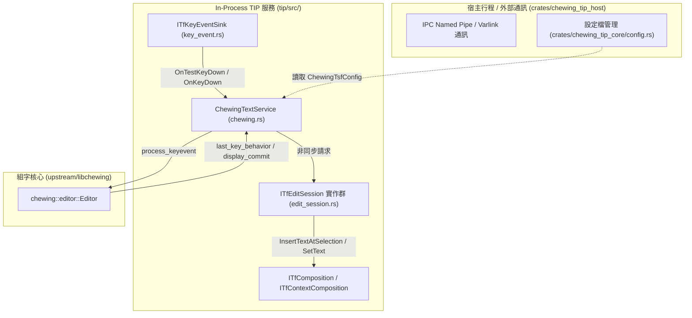

# Windows 平台 TSF 輸入法深度研究報告 (Platform Deep Dive: Windows TSF)

> **研究對象**：`windows-chewing-tsf` (`053d31ba10c089ae98508dd4a908ac2c2be3cb49`)  
> **目標**：精確剖析 Windows Text Services Framework (TSF) 的生命週期、按鍵分流、非同步編輯會話 (`ITfEditSession`)、字串提交機制，並確立最小侵入式的 Adapter 接點。

---

## 1. Windows TSF 核心架構與元件職責

`windows-chewing-tsf` 採用現代 Rust workspace 架構（Edition 2024 / Resolver 3），主要元件如下：



---

## 2. 按鍵事件處理完整生命週期 (Key Handling Lifecycle)

### 2.1 測試按鍵階段階段：`OnTestKeyDown`
- **COM 介面**：`ITfKeyEventSink::OnTestKeyDown(pContext, wParam, lParam, pfConsumed)`
- **實作函式**：`ChewingTextService::on_test_keydown` (`tip/src/text_service/chewing.rs#L388-L514`)
- **生命週期職責**：
  TSF 規範要求 IME 在此階段回報是否會「消耗」（Consume）此按鍵，但**不可在此階段修改文字或啟動組字**。
- **現有關鍵過濾閘門**：
  1. `Alt` 鍵按下：`if evt.is_state_on(KeyState::Alt) return Ok(false);`（直接放行）。
  2. `Ctrl` 鍵按下：非加詞/選字狀態直接放行。
  3. 未在組字狀態（`!self.is_composing()`）：
     - 英文模式且半形時直接放行。
     - 非列印字元直接放行。
     - 空白鍵若非全形模式直接放行。

### 2.2 實際按鍵階段：`OnKeyDown`
- **COM 介面**：`ITfKeyEventSink::OnKeyDown(pContext, wParam, lParam, pfConsumed)`
- **實作函式**：`ChewingTextService::on_keydown` (`tip/src/text_service/chewing.rs#L516-L733`)
- **轉換流程**：
  1. `ev.to_keyboard_event(self.keymap)` 將 Win32 鍵碼轉為 `chewing::input::KeyboardEvent`。
  2. 檢查自訂快速鍵（`keybindings`）。
  3. 送入組字核心：`self.chewing_editor.process_keyevent(evt)`。
  4. 判定回傳行為：`let last_behavior = self.chewing_editor.last_key_behavior()`。

---

## 3. 提交機制深度剖析：`InsertText` vs `SetCompositionString`

Windows TSF 的文字提交在 `chewing.rs` 中嚴格區分為兩條獨立路徑：

### 3.1 路徑 A：非組字狀態下的立即提交 (Direct Insertion)
當使用者在沒有未完成注音的情況下觸發了可提交按鍵（`!self.is_composing() && last_behavior == EditorKeyBehavior::Commit`）：
1. 取得提交文字：`let text = self.chewing_editor.display_commit().to_owned();`
2. 呼叫 `self.insert_text(context, &text)` (`tip/src/text_service/chewing.rs#L1046`)。
3. 透過 `request_edit_session(context, self.tid, InsertText::new(...), TF_ES_ASYNC | TF_ES_READWRITE)`。
4. 在 `InsertText::DoEditSession` 中：
   ```rust
   let insert_at_selection: ITfInsertAtSelection = self.context.cast()?;
   let range = insert_at_selection.InsertTextAtSelection(ec, INSERT_TEXT_AT_SELECTION_FLAGS(0), &self.text)?;
   range.Collapse(ec, TF_ANCHOR_END)?;
   set_selection(&self.context, ec, range, TF_AE_END)?;
   ```
   **特點**：此路徑完全不建立 `ITfComposition` 物件，不產生下劃線，直接將 UTF-16 文字插入游標處。

### 3.2 路徑 B：組字狀態下的提交與 Preedit 更新 (In-Composition Commit)
當使用者正在組字中（`self.is_composing()`）：
1. 呼叫 `self.update_preedit(context, commit)` (`#L986`)。
2. 呼叫 `self.set_composition_string(context, &commit, &composition_buf, segments, cursor)`。
3. 在 `SetCompositionString::DoEditSession` (`tip/src/text_service/edit_session.rs#L113-L173`) 中：
   - 若尚未啟動 composition，透過 `context_composition.StartComposition(ec, &range, &self.composition_sink)` 啟動。
   - 將 `commit` 與 `preedit` 合併為單一字串：
     ```rust
     let text = HSTRING::from(format!("{}{}", pending.commit, pending.preedit));
     range.SetText(ec, 0, &text)?;
     ```
   - **關鍵平移操作**：
     ```rust
     let mut moved = 0;
     range.ShiftStart(ec, pending.commit.chars().count() as i32, &mut moved, ptr::null())?;
     composition.ShiftStart(ec, &range)?;
     ```
     將前面屬於 `commit` 的範圍**移出** composition 邊界，應用程式隨即接收到已提交文字；後面的 `preedit` 則套用 `GUID_PROP_ATTRIBUTE` 顯示下劃線。

---

## 4. 最小修改方案 (Minimal Adapter Patch Points)

基於上述生命週期分析，Windows 端的 ASCII-first 修改只需要在兩個點介入：

### 接點 1：`on_test_keydown` 按鍵放行閘門（預防被吞）
* **檔案**：`tip/src/text_service/chewing.rs`
* **位置**：約第 482 行（`if !self.is_composing() { ... }` 區塊內部）。
* **邏輯**：
  在非組字狀態下，若目前 Profile 為 `markdown` 或 `code`，且按鍵為常見的 ASCII 語法標點（如 `:`、`[`、`]`、`{`、`}`、`_`、`` ` `` 等），**直接返回 `Ok(false)`**！
* **效果**：TSF 會直接通知作業系統「此按鍵由焦點應用程式自行處理」，按鍵以最乾淨的虛擬鍵碼直接進入編輯器，完全繞過 `libchewing` 內部惡名昭彰的 `special_symbol_input` 查表！

### 接點 2：`update_preedit` 提交文字轉換（防止組字誤轉）
* **檔案**：`tip/src/text_service/chewing.rs`
* **位置**：約第 715 行與第 986 行。
* **邏輯**：
  若在組字期間產生了 `commit` 字串，傳入 `policy_core::transform_commit(&commit, &policy_context)`，依當前 Profile 決定是否保持半形 ASCII。

---

## 5. 系統隔離與不安裝覆蓋保證

為保證研發過程中**絕不干擾**使用者現有的正式新酷音輸入法，採取以下隔離措施：
1. **獨立 COM CLSID**：
   在 `crates/tsfreg/src/lib.rs` 與 `tip/src/text_service/mod.rs` 中，定義測試用專屬 GUID：
   * 原版 GUID: `{E9164DE5-0E9E-4340-9E11-209B0E9C7E2E}` (範例)
   * 開發版 GUID: `{D4C3B2A1-0E9E-4340-9E11-209B0E9C7E2E}`
2. **獨立註冊表與詞庫目錄**：
   註冊表路徑由 `HKCU\Software\Chewing` 變更為 `HKCU\Software\ChewingDev`。
   使用者詞庫儲存於 `%APPDATA%\ChewingDev\`。
