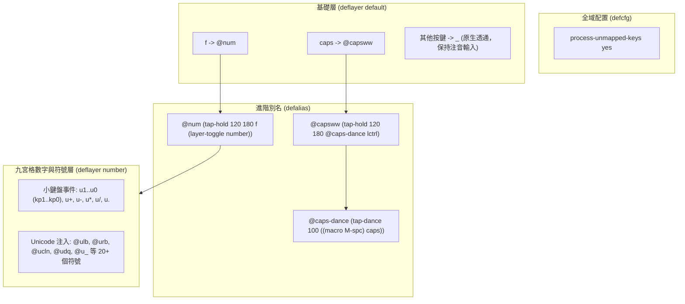
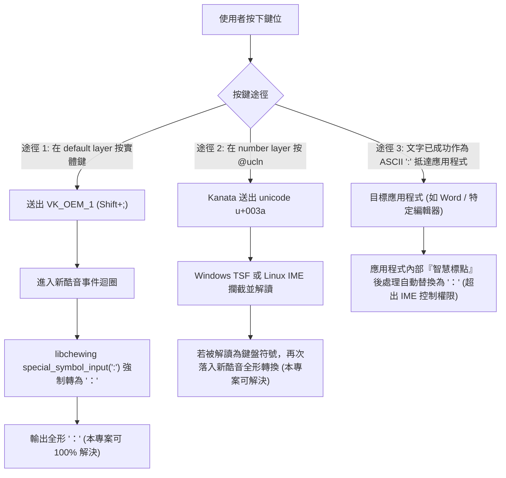

# Kanata 原始配置深度互動與穿透性分析 (Kanata Interaction Analysis)

> **基準配置**：[`config/kanata.original.kbd`](../config/kanata.original.kbd)（**不可修改之唯讀基準**）  
> **目標**：逐條剖析使用者原始 Kanata 配置中的映射行為、Unicode 注入路徑、小鍵盤事件流，並釐清 OS、IME 與目標應用程式之間的交互關係與責任邊界。

---

## 1. 使用者原始配置架構解剖

使用者的 `kanata.original.kbd` 定義了精簡但功能高度密集的層級結構：



---

## 2. 關鍵按鍵行為與事件流剖析

### 2.1 Caps Lock 連擊與長按：`@capsww`
* **定義**：
  ```lisp
  (defalias
    caps-dance (tap-dance 100 ((macro M-spc) caps))
    capsww (tap-hold 120 180 @caps-dance lctrl)
  )
  ```
* **行為拆解**：
  1. **長按超過 180ms**：輸出 `Left Ctrl`。
     - **對 Vim/開發者之意義**：使用者以此作為 Vim 的主要控制鍵（如 `Ctrl+[`、`Ctrl+w`、`Ctrl+d`）。
     - **IME 適配要求**：輸入法**絕對不得攔截**任何伴隨 `Left Ctrl` 的單鍵命令。在 Windows TSF (`chewing.rs#L460`) 與 Fcitx5 中，均已確認 Ctrl 組合鍵直接放行給應用程式。
  2. **短按（小於 120ms）單擊**：觸發 `(macro M-spc)`。
     - **OS 行為**：在 Windows 上為 `Win + Space`，在 Linux 上通常對應 `Super + Space`。
     - **功能意圖**：觸發作業系統的原生輸入法切換（中文 ↔ 英文）。
  3. **短按雙擊（100ms 內連擊）**：觸發真正的 `Caps Lock`。

---

### 2.2 長按進入九宮格與符號層：`@num`
* **定義**：
  ```lisp
  num (tap-hold 120 180 f (layer-toggle number))
  ```
* **行為拆解**：
  1. **短按 `f`**：輸出普通字母 `f`（在標準注音鍵盤對應注音符號「ㄑ」）。
  2. **按住 `f` 不放**：切換至 `number` layer。

---

## 3. 雙重事件流：小鍵盤事件 (Keypad) vs Unicode 注入

在 `number` layer 中，使用者混合使用了兩種截然不同的輸出技術：

### 3.1 途徑 A：數字小鍵盤事件 (`kp1` - `kp0`)
* **配置清單**：
  ```lisp
  u1 kp1  u2 kp2  u3 kp3
  u4 kp4  u5 kp5  u6 kp6
  u7 kp7  u8 kp8  u9 kp9
  u0 kp0  u- kp-  u. kp. 
  u+ kp+  u* kp*  u/ kp/
  ```
* **穿透行為**：
  - Kanata 向作業系統發送標準的 **小鍵盤虛擬鍵碼 (VK_NUMPAD0 - VK_NUMPAD9)**。
  - **Windows TSF**：由 `VKEY_MAP` 轉換為相應的數字字元，不觸發注音組字。
  - **Linux Fcitx5**：若 Fcitx5 未開啟 `UseKeypadAsSelectionKey`，直接作為數字送達；若處於選字視窗且開啟了小鍵盤選字，則作為選字鍵。

### 3.2 途徑 B：Unicode 直接注入 (`(unicode u+00xx)`)
* **配置清單**：
  - 括號類：`@ulb` (`U+005B` `[`), `@urb` (`U+005D` `]`), `@ulc` (`U+007B` `{`), `@urc` (`U+007D` `}`), `@ulp` (`U+0028` `(`), `@urp` (`U+0029` `)`)
  - 標點類：`@ucln` (`U+003A` `:`), `@usme` (`U+003B` `;`), `@udq` (`U+0022` `"`), `@uqt` (`U+0027` `'`), `@u_` (`U+005F` `_`), `@u|` (`U+007C` `|`), `@u\` (`U+005C` `\`)
  - 比較與運算：`@ult` (`<`), `@ugt` (`>`), `@uqst` (`?`), `@u=` (`=`)
  - 第一排數字符號：`@u!` (`!`), `@u@` (`@`), `@u#` (`#`), `@u$` (`$`), `@u%` (`%`), `@u^` (`^`), `@u&` (`&`), `@u~` (`~`), `@u\`` (`` ` ``)
* **穿透行為與潛在衝突分析**：
  1. **Windows 平台**：
     - Kanata 調用 Windows `SendInput`，注入帶有 `KEYEVENTF_UNICODE` 標記的鍵盤事件。
     - **衝突場景**：某些老舊 Win32 軟體或自定義文字編輯框在收到 Unicode 封包時，會轉換為 `WM_CHAR`。如果焦點視窗掛載了全形字元轉換，字元可能被篡改。但若該事件被 TSF 的 `ITfKeyEventSink` 解讀為鍵盤事件，且當時輸入法處於中文組字狀態，就可能被 TSF 或輸入法錯誤捕捉。
  2. **Linux 平台**：
     - Kanata 在 Linux 下實現 Unicode 注入，通常透過模擬 IBus/GTK 的 `Ctrl + Shift + U` 加上 16 進位碼（如 `3 a`）再按 `Enter`。
     - **衝突場景**：**極易被中文輸入法破壞**！當 Fcitx5 處於中文狀態時，`Ctrl+Shift+U` 可能觸發輸入法內部的快捷鍵，或者中間輸入的 `3`、`a` 會被輸入法解讀為數字或拼音，導致整個 Unicode 注入序列崩潰！

---

## 4. 為什麼「(unicode u+003a) 依然可能變成全形 ：」？

根據原始碼追蹤與系統架構分析，當使用者在日常使用中發現 `:` 變成了 `：`，存在以下三種真實路徑：



### 責任邊界結論：
* **路徑 1 與路徑 2**：輸入法前端具有完全的攔截與修正權力，本專案的 `policy-core` 與 Adapter-first 方案能夠精確保證輸出為 ASCII 半形 `:`。
* **路徑 3**：文字已由 IME 成功提交，被應用程式內部的事後自動校正篡改。此情境輸入法無法亦不應違法監控，規格書明確規範由使用者關閉該應用程式之自動轉換功能。
