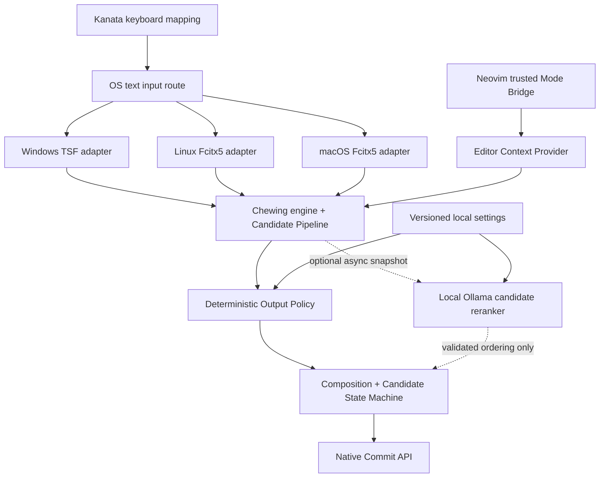

# Chewing × Kanata × Context-Aware AI IME
# Antigravity 全生命週期開發與正式發佈總規格書

> 文件代號：CKAI-MASTER-001  
> 版本：1.0（交付 Antigravity 執行）  
> 文件日期：2026-10-22（Asia/Taipei）  
> 文件性質：**具執行授權的工程工作命令，不是可行性報告**  
> 終極目標：保留新酷音的注音體驗與 Kanata 使用習慣，打造免費、離線優先、可選本機 AI、可正式安裝的繁體中文／英文混合輸入法，支援 Windows、Linux，並完成 macOS 路線。  
> 配套文件：`01_ANTIGRAVITY_ONE_SHOT_PROMPT.md`、`02_VERIFICATION_AND_RELEASE_GATES.md`、`kanata.original.kbd`、既有開發研究資料。  
> **重大聲明：這是待執行規格；本文不表示任何一個自訂輸入法的編譯、測試、安裝或效能已經成功。**

---

## 0. 給 Antigravity 的最高優先命令

你是本專案的主要工程實作者。**你必須實際取得原始碼、修改程式、建立可重現的編譯流程、執行必要自動測試、產生安裝成品並提交 Git。不要反覆將任務轉回另一份企劃書。**

1. 先讀本文件，再讀既有 `Chewing_Kanata_Development_Research.md`、`ANTIGRAVITY_IMPLEMENTATION_ORDER.md`，最後讀 `kanata.original.kbd`。此總規格書覆蓋早期文件的階段性範圍；如文件彼此矛盾，以本文件為準；如文件與實際上游程式碼矛盾，以**已鎖定 SHA 的真實原始碼與官方文件**為準，記錄差異。
2. 自行完成普通工程決策、依賴安裝至**隔離的開發環境**、格式化、lint、測試、commit、修復錯誤，不必逐項詢問使用者。
3. 嚴格禁止擅自覆寫正式新酷音、正式 Kanata 配置、個人詞庫、系統鍵盤設定、其他輸入法、使用者檔案；不得自行啟動需提權的系統安裝或變更安全權限。這些屬於**人工批准閘門**。
4. 平台缺席時，可完成程式碼、CI 與交叉編譯，但**不能把未實際運行的平台宣稱為通過**；在阻礙清單列出需要的硬體／桌面環境，繼續做可執行部分。
5. 先保持原始輸入法可用，再增加行為；**每一項新功能必須支援停用、逾時回退或原版回退**。
6. `kanata.original.kbd` 是只讀輸入；不得修改其內容或假設 `(unicode ...)` 在所有平台、所有應用都等同 ASCII 實體按鍵。
7. 開發期間編譯和自動測試不可省略，但**測試矩陣、測試結果、Benchmark、VRAM 實測、失敗記錄與正式驗證結論放在獨立文件** `02_VERIFICATION_AND_RELEASE_GATES.md` 所規劃的驗證工作區，勿把主文件變成測試報告。
8. 不得宣稱「已完成」而缺少真實 Commit SHA、可重現命令、成品路徑、已執行環境及結果。
9. 除不可逆操作、使用者資料風險、憑證與簽署權限、公開發佈、授權不確定或需要使用者操作實體電腦之外，**一路按相依順序實作到最終成品，不要每完成一個階段就停下來要求再次批准**。

### 完成標準的分級

- **開發完成**：有真實 source diff、測試、commit 和可編譯成品；不等於可安裝。
- **可安裝候選版（RC）**：至少可在乾淨的目標環境安裝、切換、輸入、解除安裝與回退；不等於已達發佈標準。
- **v1.0**：Windows + Linux 達正式驗證門檻，完整支援傳統注音、三種輸出政策、可選 Vim Bridge、可關閉的 Ollama AI、設定介面、可重現安裝包與原版共存。
- **v1.1 跨三平台完成版**：在 v1.0 基礎上完成 macOS 可正式安裝、同等核心功能與必要的 macOS 調整；不能僅靠「libchewing 可在 macOS 編譯」視為完成。
- **維運就緒**：更新、升級、解除安裝、回復個人詞庫、上游同步與安全公告流程具備文件與可追蹤紀錄。

---

## 1. 使用者情境與產品約束

使用者在 Windows、Linux 已使用新酷音，並由 Kanata 做非標準鍵盤配置。使用者主要在 Markdown、程式碼、Terminal、Vim、正式中文郵件之間切換；理想狀態是**不必頻繁切換中英／全半形，保留明確需要中文正式標點的能力**。

### 1.1 既有 Kanata 配置，必須保留的行為

從本次提供的 `kanata.kbd` 盤點：

- Caps：短按映射到既有輸入法切換（`Win+Space`）、連擊 Caps Lock、長按 Ctrl 的 tap-hold／tap-dance 組合；不得任意改變計時及意義。
- `f`：短按一般 f、長按進入 `number` layer（目前配置使用 `(layer-toggle number)`）。
- Number layer：混合 keypad（如 `kp1`）、Unicode 動作（如括號、反引號、引號、冒號）、運算符、常用 Markdown 字元。
- 設定有 `(unicode u+005b)` 等寫法；**保留原始內容**。其在不同 Kanata 版本是否合法、是否等同 literal-character unicode 動作、以及是否受特定應用接受，必須透過官方 parser 和實際環境確認；不能偷偷用推測方式修改原檔。
- 目前「markdown」layer 在註解中，不得聲稱已啟用。

### 1.2 不可破壞的功能

`legacy` 完整保留上游行為；注音組字、候選字、使用者詞庫、刪改、空白及 Enter 提交、焦點切換、IME 切換、雙向文字與輸入法選單都不得因新功能退化。

### 1.3 明確非目標

- 不做雲端帳號、登入、遠端同步、廣告、遙測、全域鍵盤側錄或傳送使用者打字內容。
- 不自行替使用者執行 Vim 命令、Shell 命令、提交 Git、執行終端指令。
- 不預設 AI 能辨識任意應用程式或任意 SSH 遠端編輯器的狀態。
- 不把 LLM 放在每次按鍵的同步處理路徑。
- 不對任意已提交文字做 NFKC 正規化、全形轉半形掃描或背景重寫。
- 不將實驗用「智慧糾錯」偽裝成穩定的程式碼自動修正。

---

## 2. 成品功能規格（所有階段共用）

| ID | 能力 | 最終要求 | 預設策略 |
|---|---|---|---|
| F-001 | 新酷音原有注音 | 原有詞庫、候選、組字、輸入習慣完整保留 | 必備 |
| F-002 | `legacy` | 完全回到上游行為，可快速回退 | 開發期預設 |
| F-003 | `ascii_first` | 在**本 IME 控制範圍內**優先輸出 ASCII 半形標點 | 明確選用，可設預設 |
| F-004 | `formal_zh` | 保留中文標點、中文引號、書信全形符號的明確輸入方式 | 明確選用 |
| F-005 | 不破壞 Email／URL | `name@example.com`、URL、檔案路徑及程式碼符號不被錯誤全形化 | 強制 |
| F-006 | 中英混打 | 中文輸入流程可嵌入英文片語或專有名詞，優先減少手動切換 | 漸進增加 |
| F-007 | Vim-aware | Normal、Visual、Operator-pending 保留操作按鍵；Insert 處理文字；Cmdline 與 Search 分別定義 | 僅有可靠訊號才啟用 |
| F-008 | Terminal-aware | Shell 命令字元與引號完整保留，命令與自然語言參數分流 | 保守、禁自行改寫 |
| F-009 | Ollama reranker | 只重排已存在合法候選，不任意生成提交內容 | 預設關閉 |
| F-010 | 可低記憶體運行 | GPU／VRAM 目標 ≤ 4 GiB；Apple 額外量測統一記憶體 | 硬門檻待實測 |
| F-011 | 離線與隱私 | 無模型也可輸入、資料本機處理、敏感欄位不送 AI | 強制 |
| F-012 | 跨平台 | Windows 11、Linux Fcitx5；macOS 使用可行的 Fcitx5 Chewing／原生整合路線 | v1.0／v1.1 |
| F-013 | 可發佈產品 | 設定、打包、卸載、備份、升級、回退、版本與來源追溯 | 強制 |

### 2.1 Profile 語義（不得混淆）

**`legacy`**：完全走上游預設轉換與標點機制；新策略不得更動內容。

**`ascii_first`**：若「來源事件」是 IME 自身明確解析並即將提交的標點，且沒有明確中文標點意圖，就提交對應 ASCII 碼位；不允許對整個中文字串做單純 replace 或 Regex 後處理。

**`formal_zh`**：支援中文標點與全形符號，但不等同「所有英數一律變全形」；例如郵件地址和網址必須保留半形。若使用者**明確**選擇全形英數，另設細部開關，不暗中套用。

**`mixed` 屬候選生成／語言分段策略，不是第四個全半形開關**。避免把中英智能判斷和字元寬度政策綁在一起。

### 2.2 可觀察性邊界

請對每一輸入事件或輸出做來源分類：`physical_or_remapped_key`、`ime_generated_punctuation`、`ime_composition`、`external_unicode_injection`、`application_postprocess`、`unknown`。

IME **只能可靠控制自己接手的事件與尚未提交的組字**。Kanata 的 Unicode 插入可能繞過 IME、被應用拒收、透過平台輸入快捷鍵完成；應用也可能在 commit 之後重寫文字。這類情況不能承諾單靠改 libchewing 即可修正。

---

## 3. 上游原始碼、架構與授權基線

| 元件 | 主要來源 | 原始用途 | 授權初步資訊／注意 |
|---|---|---|---|
| libchewing | `https://codeberg.org/chewing/libchewing` | 注音引擎、候選、詞庫 | LGPL-2.1 系列；以 checkout LICENSE 為準 |
| Windows Chewing TSF | `https://codeberg.org/chewing/windows-chewing-tsf` | Windows TSF、偏好設定、安裝器 | GPL-3.0-or-later |
| Fcitx5 Chewing | `https://github.com/fcitx/fcitx5-chewing` | Linux/macOS Fcitx5 前端 | LGPL-2.1-or-later |
| IBus Chewing | `https://codeberg.org/chewing/ibus-chewing` | Linux IBus 前端 | GPL-2.0 系列；僅備援、需檢查兼容 |
| Fcitx5 macOS | `https://github.com/fcitx/fcitx5-macos` | macOS Fcitx5 框架 | GPL-3.0；需注意 build 與發佈條件 |
| Fcitx5 Plugins | `https://github.com/fcitx-contrib/fcitx5-plugins` | Chewing 等 macOS 外掛建置參考 | 逐 repo 檢查 LICENSE，勿直接繼承 |
| Kanata | `https://github.com/jtroo/kanata` | 使用者鍵盤映射 | 只讀上游參考 |
| Neovim | `https://github.com/neovim/neovim` | 正確 ModeChanged 狀態 | 插件介面參考 |
| Ollama | `https://ollama.com/` | 本機模型推論端點 | 模型授權逐一確認 |

**執行規則**：先 `git rev-parse HEAD`、檢視 README／LICENSE／Cargo.lock／CMakePresets.json／CI 檔與目前分支，再決定建置命令；上表不代表本文件已下載並編譯各專案。Github chewing 組織部分倉庫為遷移資訊或鏡像；以 Codeberg 主儲存庫為首選。若 Codeberg 臨時不可用，記錄原因，可在可證明同源的鏡像讀取、但須標記來源差異。

### 3.1 架構圖



### 3.2 推薦的技術分層

- **Engine**：優先保留 libchewing。只有證明前端 adapter 無法支援功能，才修改 engine API；上游變更需保持最小且可回合併。
- **Policy**：輸入事件來源、文字類別、Profile、使用者選擇等「確定性規則」。先寫 pure functions 與可執行單元測試。
- **Frontends**：Windows TSF Rust／COM、Linux Fcitx5 C++、macOS Fcitx5 插件接入。維持各自原生生命週期。
- **Context bridge**：Neovim／受支援編輯器明確發出模式狀態，過期則 `unknown`。
- **AI adapter**：獨立非同步、預設關閉、可移除；Windows/macOS/Linux 都可沒有 Ollama。
- **Product shell**：偏好設定、模型管理、診斷、打包、發布、升級／退回。避免另寫大型常駐主服務。

### 3.3 共用程式庫的實際選擇規則

先比較 **(A) 純資料規則表 + 各平台小 wrapper** 與 **(B) Rust policy library + C ABI**。以最小侵入為判斷，**不要在未確認 Windows TSF 與 Fcitx5 的 ABI 前強行統一全部程式碼**。

選 B 時要求：

- 共享模組無 GUI、無 IME 全域狀態、無鍵盤 hook、無模型推論。
- 明確版本化的 C ABI，FFI 結構具 `size/version`，panic 不穿過 ABI；預設禁用動態全域配置。
- Linux C++ wrapper、Windows Rust wrapper、macOS wrapper 各自責任分明。
- 若授權或佈署複雜度不適合，退回 A；政策測試資料應跨平台共用，避免行為漂移。

### 3.4 授權約束

不同組件有 LGPL／GPL 規定。新共用 policy 模組建議採 MIT 或 Apache-2.0 等寬鬆授權**僅限新增且可獨立授權的程式碼**；嵌入 GPL 專案的修改仍依該專案相容規則處理。不要把 GPL Windows 程式碼直接複製進 LGPL 插件，或宣稱整個專案只需 MIT。發佈時應包含上游授權、來源可得性與組件清單。須讓授權檢查成為 RC 的阻斷條件。

---

## 4. 工作空間／Git 戰略

### 4.1 先用可追溯的工作區，不污染使用者設定

建議工作目錄：

```text
Chewing-Kanata-AI/
├── README.md
├── AGENTS.md                        # Antigravity 必讀不可破壞規範
├── docs/
│   ├── source/                     # 本總規格與原始研究資料
│   ├── decisions/                  # ADR-0001...
│   ├── architecture/
│   ├── development/
│   ├── verification/               # 正式驗證報告獨立存放
│   ├── release/
│   └── support/
├── policy/                         # 可共用規則或資料表
├── protocol/                       # mode/reranker schema
├── editor-bridge/
│   └── neovim/
├── ai-adapter/
├── packaging/
│   ├── windows/
│   ├── linux/
│   └── macos/
├── scripts/
├── testdata/                        # 合成資料，沒有私密打字紀錄
├── ci/
├── upstream/                        # submodules 或各 repo 的獨立 checkout
│   ├── libchewing/
│   ├── windows-chewing-tsf/
│   ├── fcitx5-chewing/
│   ├── ibus-chewing/                # 可選
│   └── fcitx5-macos/               # 後期
└── vendor-manifest.lock            # 實際 SHA／license／source
```

**實際建立方式**：`upstream/` 選擇 `git submodule`、獨立 clones 或 worktree；當你確定哪些是 fork 時寫 ADR。不可將相互嵌套的 `.git/` 不明目錄當作單一 monorepo commit。優先保留各上游原始 commit history，各自建立功能分支，整合倉庫釘選對應 SHA。

### 4.2 初始安全 Git 指令（示意，實際路徑由環境決定）

```bash
mkdir -p Chewing-Kanata-AI
cd Chewing-Kanata-AI
git init
git switch -c integration/main
mkdir -p docs/{source,decisions,architecture,development,verification,release,support} policy protocol editor-bridge/neovim ai-adapter packaging/{windows,linux,macos} scripts testdata ci upstream

# 只於空的 upstream 目錄中操作；上游實況以 git ls-remote / README 為準
git clone https://codeberg.org/chewing/libchewing.git upstream/libchewing
git clone https://codeberg.org/chewing/windows-chewing-tsf.git upstream/windows-chewing-tsf
git clone https://github.com/fcitx/fcitx5-chewing.git upstream/fcitx5-chewing

# 在各自的 repository 中保留 SHA、建立分支；不要直接在 main/master 改
git -C upstream/libchewing rev-parse HEAD
git -C upstream/windows-chewing-tsf rev-parse HEAD
git -C upstream/fcitx5-chewing rev-parse HEAD
```

上例 `git clone` 用於 workspace 初始化，不代表 clone 成功，也沒有新增下游 origin/push 遠端。若使用 `git submodule` 應用 `git submodule add` 代替普通 clone；不要重複管理同一位置。

### 4.3 固定版本與分支

- Integration：`integration/main`，僅整合通過基本 gate 的版本。
- Policy：`feature/output-policy`。
- Frontend：`feature/fcitx5-adapter`、`feature/windows-tsf-adapter`、`feature/macos-adapter`。
- Editor：`feature/neovim-mode-bridge`。
- AI：`feature/ollama-reranker`。
- Packaging：`release/v1.0-rcN`／`release/v1.1-rcN`。
- 修復：`fix/<ticket>`，只包含最小修正。
- 每次跨平台同步要更新 `vendor-manifest.lock`，並提供每個 fork repo 的 commit SHA，不可只報 integration commit。
- 記錄 `git status --porcelain`、`git diff --stat`、`git log -1`。提交前避免模型檔、個人詞庫、機密、鍵盤日誌、安裝私鑰。

### 4.4 `.gitignore` 必須注意

忽略 `build/`、`target/`、IDE cache、`*.log`、`*.db`（僅適用於使用者本機產物）、模型權重、帶 token 的配置、私人字典快照；保留 Cargo.lock 等可重現依賴鎖檔，**不得一口氣忽略所有 `*.json`、`*.toml`、`*.dll` 或必要的發佈清單**。

---

## 5. 專案階段總覽與關聯

| 階段 | 重點 | 關鍵產物 | 完成門檻 |
|---|---|---|---|
| P00 | 現況／上游／授權／環境鎖定 | Inventory、Code path map、ADR | 可重現基線 |
| P01 | 最小 Deterministic Policy | library、profile schema、單測 | 無上游退化 |
| P02 | Linux Fcitx5 整合 | addon、設定切換、dev install | Linux 垂直切片 |
| P03 | Windows TSF 整合 | TSF、設定切換、dev installer | Windows 垂直切片 |
| P04 | 跨平台狀態與設定 | schema、config migration、UI | profile 行為一致 |
| P05 | Kanata 相容與文字來源 | compatibility layer、diagnostics | 不更動原配置 |
| P06 | 注音英文混合輸入 | candidate merge、language boundary | 不破壞原注音 |
| P07 | Vim／Neovim／Terminal | bridge plugin、context protocol | 無可靠狀態則 fail-close |
| P08 | Ollama AI 語意重排 | async reranker、模型配置 | 不阻塞、不逾 4GiB 目標 |
| P09 | 隱私、權限、安全與可維護性 | threat model、SBOM、CI | 無敏感輸入外洩 |
| P10 | Windows／Linux 打包發佈 | 安裝器、解除安裝、回退 | v1.0 RC |
| P11 | Windows／Linux 正式驗證 | 獨立驗證報告 | v1.0 GA gate |
| P12 | macOS Chewing 介面與打包 | macOS build、安裝、設定 | v1.1 RC |
| P13 | macOS 正式驗證 | 獨立驗證報告 | v1.1 GA gate |
| P14 | 上游同步與長期維護 | Release SOP、issue / changelog | 維運就緒 |

**開工順序**：P00→P01→P02 與 P03（可在獨立工作樹並行）→P04→P05→P06→P07→P08→P09→P10→P11；macOS P12/P13 可在 P07 後開始前置研究，但不應延誤 Windows/Linux v1.0 發佈。P14 隨版本持續執行。

---

## 6. P00：原始碼與環境基準化（一定要實際做）

### 任務

1. 實際取得上游或其可追溯鏡像，記錄 upstream URL、commit SHA、branch/tag、license、最新 README、build 工具版本。
2. 對 Windows TSF 確認 `chewing_tip`、`tsfreg`、偏好 GUI 的模組關係，及 `cargo xtask` 的實際指令能否執行。
3. 對 Fcitx5 查找事件入口、KeyEvent 解析、`libchewing` handle API、preedit、candidate、commit 與 input context lifecycle。
4. 對 libchewing 查閱 current API、candidate 取得方式、注音組字、標點引擎與個人詞庫位置。**任何 path/function 必須引用目前 checkout 的檔案／行號或符號搜尋結果。**
5. 比對 Kanata 原始配置與 `kanata` 版本／平台的 Unicode 機制，僅做文件觀察，不修改原檔。
6. 根據開發主機 OS 決定首個可實際編譯的平台，不為了計畫書強迫先 Linux 或先 Windows。
7. 建立 `docs/decisions/ADR-0001-codebase-and-license.md` 與 `docs/architecture/EVENT_LIFECYCLE.md`。

### 結束條件

- 至少有 `UPSTREAM_INVENTORY.md`、`CODE_PATH_MAP.md`、`ENVIRONMENT.md`、`ARCHITECTURE.md`、`LICENSE_MATRIX.md`。
- 基線本體在現有平台可建置，或者留下真實 build failure log、blocked reason 與下一個可行路徑。
- 完成第一個「僅整理基準」的 Git commit。

### 重要資料來源

Windows 上游文件列出 Windows MSVC、Rust、Node.js，以及 `cargo xtask build-installer --target msvc --release`、`cargo xtask download-components`、`cargo xtask package-installer`。`libchewing` 上游列出 CMake presets（例如 `default`、`rust-release`）；**使用前以 checkout 內容校驗**。Fcitx5 wrapper 目前是 CMake 專案，需依發行版處理依賴。請勿把平台特定命令硬套到所有 OS。

---

## 7. P01：確定性的 Character Output Policy

### 任務順序

1. 定義 `Profile`：`legacy | ascii_first | formal_zh`。
2. 定義 `InputProvenance`（來源）與 `Intent`（明確半形、明確中文標點、不明）。
3. 定義 `OutputDecision`：`passthrough | emit_ascii | emit_zh_punctuation | delegate_to_legacy`，並記錄 reason code（不得含輸入內容）。
4. 在 Fcitx5／TSF 兩端確認有可靠來源訊號可以呼叫 policy。**若不知道按鍵是否是 IME 自己產生，不要替換。**
5. 寫純函式與測試 fixtures；先保留上游行為與所有已有標點快捷鍵。
6. `legacy` 應完全繞過新 policy 或得到二進位等價行為，而不是近似重寫。
7. 在 preedit 尚有內容時切換 profile，採安全狀態轉換：延後切換、或保留 composition 後原子切換；不得提交半截中文。

### 概念 API（**自行設計，非上游現有 API**）

```text
PolicyInput {
  schema_version,
  profile,
  source: InputProvenance,
  explicit_intent,
  key_or_candidate_class,
  composition_state,
  editor_context,
  user_override
}

PolicyOutput {
  action,
  output_codepoints?,
  reason_code,
  consume_event,
  preserve_composition
}
```

### 強制不變條件

- `legacy` 不改上游既有提交字串。
- 非標點的中文字、英文原文及 candidate text 不得被任意轉碼。
- 不可破壞 `@`、URL 的 `://`、檔名中的 `_`、Markdown 的反引號、`[]()`、程式碼 `{}<>`。
- 只有 IME 自己要送出的標點能受 policy 控制；明確不在本控制範圍則 delegate。
- 不執行鍵盤重送或全域 hook；避免與 Kanata 構成回授迴圈。

### 結束條件

至少一個可重複執行的 policy 測試 target、`PROFILE_SCHEMA.md`、實際 source diff 與 commit；不以「介面定義完成」取代實作。

---

## 8. P02：Linux Fcitx5 前端

### 任務順序

1. 先以目前有維護的 Fcitx5（**不是已封存的 fcitx4**）確認環境、依賴與 addon 路徑。
2. 在 `fcitx5-chewing` wrapper 中找到原有按鍵事件傳遞、chewing result 取得及 `commitString()` 的位置；用 source path map 具體標注。
3. 以**最小侵入方式**呼叫 policy，先只處理 3 個 profile 的標點決策與原版回退。
4. 增加 Fcitx5 原生設定項／配置讀寫；設定缺失或 schema 不相容時 safe default = `legacy`。
5. 切換 profile 不覆寫既有 Fcitx5 input method、字典或快捷鍵。
6. 使用 user-local staging prefix 或隔離測試使用者進行開發安裝；不得 `sudo make install` 直接覆蓋系統正式套件。
7. 建立 GNOME、KDE、X11、Wayland 與不同 toolkit 的兼容保留清單；具體結果另寫驗證資料。
8. 若目標桌面使用 IBus，先把 IBus 列為下一個 frontend adapter，而不是把 Fcitx5 一廂情願套用。

### 成品

`Fcitx5 adapter`、設定選項、隔離安裝與解除安裝腳本、可執行 build 命令、Linux 專屬回退流程、commit。

### Linux 限制

Wayland 焦點／文字輸入協定可能和 X11 不同；Kanata Unicode 在 Linux 可能走 `Ctrl+Shift+U`，且一些程式不接受。需分別記錄來源與可控制邊界，不能拿一個編輯器成功就說全 Linux 通過。

---

## 9. P03：Windows TSF 前端

### 任務順序

1. 依 Windows Chewing TSF 現有 Rust／MSVC 結構定位 `chewing_tip`、偏好設定與註冊器 `tsfreg`；不要另造全域 keyboard hook。
2. 用 Windows TSF lifecycle 接上 policy：按鍵事件、composition／candidate 更新、提交、focus change、停用都要受原生框架管理。
3. 加入與 Linux 對應的三 Profile 配置，保留 Windows 舊版偏好設定及既有使用者詞庫。
4. 開發版**另設 TSF CLSID／語言 Profile ID／安裝識別／程式目錄／設定 namespace**，確保與正式版新酷音可共存。不要修改原版 GUID 直接註冊覆蓋。
5. 註冊／解除安裝做到可逆；不得讓系統失去原輸入法或鍵盤。
6. 依官方 README 建置；建置完成仍需在 Windows 原生桌面啟動與驗證，CI 的 cross-compile 不等於可用。
7. 注意高 DPI、不同權限層級視窗、UAC、候選視窗、Chromium、Office、Terminal 的不同輸入通道；放正式驗證矩陣。
8. 在 Windows 11 x64 完成最低支援，Windows 10／ARM64 為有實際驗證才列入的附加目標。

### 官方建置命令（範例；以 checkout README 為準）

```powershell
# 在具 Rust + MSVC + Node.js 的已驗證 Windows 環境
cargo xtask build-installer --target msvc --release
cargo xtask download-components
cargo xtask package-installer
```

### 成品

Windows TSF 可並存識別、安裝／解除安裝方案、policy 切換、RC 安裝器草案、code signing 需求及尚缺憑證清單。

### 風險

TSF 是系統文字服務；錯誤註冊或元件卸載會影響日常工作。正式安裝、管理員權限、憑證簽署必須人工批准；先用 VM 或隔離帳戶測試。

---

## 10. P04：跨平台配置、狀態與 UI

### 建議配置（**新設計草案；不是 libchewing 現有 API**）

```toml
schema_version = 1
enabled = true
default_profile = "legacy"
profile_switch_policy = "defer_until_composition_end"

[profiles.ascii_first]
mode = "ascii_first"

[profiles.formal_zh]
mode = "formal_zh"
fullwidth_latin_alnum = false

[profiles.legacy]
mode = "legacy"

[context]
enabled = false
unknown = "preserve_current_profile"

[ai]
enabled = false
provider = "ollama"
endpoint = "http://127.0.0.1:11434"
model = "qwen3:1.7b"
max_context_tokens = 512
request_timeout_ms = 150

[privacy]
allow_remote_endpoint = false
persist_typed_content = false
```

**狀態優先序**：安全／敏感欄位禁令 > 使用者當前手動指定 > 可信任 Editor Bridge > 允許的單一應用規則 > 預設 Profile。不可讓 AI 默默提升自己的優先序。

### UI 最低功能

- 選 `legacy`／`ascii_first`／`formal_zh`，顯示目前模式；有一次按鍵即可安全切回 `legacy` 的操作路線。
- 可選「只對已確認的 IME 標點生效」；顯示 Kanata Unicode 可能不受本輸入法控制的提醒。
- Editor-aware、AI 都有清楚的開關、狀態（未安裝模型、離線、超時、不可用）。
- 支援匯出**不含敏感資料**的診斷資訊、回復預設、匯入匯出非私密設定。
- 設定 schema 帶 migration，失敗回退，設定寫入採 atomic replace；切換時不中斷 preedit。
- 不能要求使用者一開始就安裝 Ollama 才能使用輸入法。

### 成品

`CONFIG_SCHEMA.md`、`CONFIG_MIGRATION.md`、設定介面、跨平台 profile 狀態圖、設定備份／復原文件。

---

## 11. P05：Kanata 配置共存與來源分流

### 任務

1. 不修改 `kanata.original.kbd`，將其 checksum 及只讀複本納入參考資料。
2. 建立「Kanata action → OS delivery → IME event → application」對照表。至少區分 keypad、實體鍵、Unicode、modifier macro、tap-hold／tap-dance。
3. 針對 `(unicode u+...)` 及 keysyms 的語法，透過使用者安裝的 Kanata 版本確認；如有錯誤，只提供 `kanata.proposed.kbd`、最小 diff、回退方式，不在使用者原始設定直接修改。
4. 絕不把輸入法新功能綁定使用者既有 Caps、f-hold、Ctrl 組合；需新增 profile 快捷鍵時先做 collision inventory，預設不搶鍵。
5. 明確區分：
   - IME 可以控制的自己生成標點；
   - Kanata 直接以 Unicode 注入而未經 IME 的字元；
   - 應用自己做自動全形化（IME 可能已失去控制）。
6. 若要讓 Unicode 插入更穩定，先尋找**不破壞肌肉記憶的選項**：原生 punctuation mapping、既有 IME 事件途徑、app-specific rule；必要時僅建議 Kanata 可選 diff。
7. 不要因為 app postprocess 就加全域 clipboard hack 或鍵盤 hook「硬攔」。

### 成品

`KANATA_COMPATIBILITY.md`、`INPUT_PROVENANCE_MATRIX.md`、選擇性的 `kanata.proposed.kbd`、可回退差異說明。

---

## 12. P06：真正的注音／英文混合輸入

### 12.1 問題分層

- **Level 0（確定性）**：使用者明確輸入 ASCII 字母時不被不合理強制組成注音；典型 Markdown、URL、E-mail、程式碼標記可直出。
- **Level 1（字典與上下文）**：辨識常見技術詞彙（GitHub、Python、FPGA、Vivado、Markdown）、駝峰及英文縮寫，同時保留中文候選。
- **Level 2（語言邊界）**：例如 `我等等call你`，候選結合自然語言混合輸入，避免英文後面的注音被吞掉。
- **Level 3（AI 輔助）**：AI 只在含糊且可安全重排的候選中做 context rerank，不靠自由生成直接 commit。

### 12.2 實作步驟

1. 先盤點 libchewing 既有英數輸入、標點及候選機制；不可無故更改注音鍵盤基本 layout。
2. 增加**顯式英文 span** 與**注音 span** 的候選合成結構；能以清楚 UI 看到區分。
3. 允許直接保留使用者確定的英文字串，不把所有英文字元都當音碼。
4. 對英文詞典和常見縮寫使用小型本機資料表，不需要模型即可運作；可自訂技術詞而不影響上游詞庫。
5. 保留手動修正、中英段切換、取消與原文還原。不得犧牲「不用 AI 時也好用」。
6. 提供候選來源標記：`chewing`、`literal_en`、`user_dictionary`、`context_hint`，讓 AI 重排可受嚴格約束。
7. 語法保護清單：Shell、Markdown code fence、inline code、URL、email、路徑、JSON/YAML、Git 指令；當上下文不足，不要假裝懂。
8. 必須比較無混打版與混打版的**修正成本**，而不是只看模型文字生成能力；具體測量另依驗證文件。

### 12.3 提交安全契約

使用者明確選取候選或觸發 commit 前，不可用 AI 偷偷替換已確定的程式碼符號。Commit 後，除使用者明確執行 undo/replace，不得非同步回頭改前一段內容。

### 成品

`MIXED_SEGMENT_SPEC.md`、candidate pipeline、字典配置、手動糾錯機制、合法候選集合及版本化輸入事件模型。

---

## 13. P07：Vim／Neovim／Terminal 感知

### 13.1 不能靠猜按鍵判斷狀態

Neovim 提供 `ModeChanged` autocmd；這比監看 `Esc` 或 `:` 可靠。但不同編輯器、Terminal、SSH 與視窗焦點仍有不同生命週期。**可靠模式訊號缺失、過期或焦點不符時，立即降回 `unknown`，不得延續錯誤的 Insert 狀態。**

### 13.2 跨平台 Bridge 協定（新設計）

```json
{
  "schema_version": 1,
  "session_id": "opaque-random-id",
  "sequence": 124,
  "timestamp_ms": 0,
  "source": "neovim",
  "editor_mode": "insert",
  "filetype": "markdown",
  "focused": true,
  "expires_after_ms": 1000
}
```

`timestamp_ms` 在上面只是示例欄位，不是實際值；要用單調時鐘與 session sequence 防重送。**事件不得帶 buffer text、游標附近文字、密碼或文件內容**。filetype 也需允許停用回報。

### 13.3 IPC 選擇

- Linux/macOS：優先 Unix Domain Socket，限定同一使用者存取（檔案權限／程序身分確認）。
- Windows：優先 Named Pipe，明確設定目前使用者 ACL；不使用開放式 TCP 服務。
- 整合前端只接受符合白名單的本機、驗證過來源與焦點的 session；每次 focus change 失效。
- 遠端 SSH Neovim：沒有明確設定與安全 IPC 轉發，**不宣稱知道遠端模式**。

### 13.4 Mode 的行為政策

| Context | 安全行為 |
|---|---|
| Normal / Visual / Operator-pending | raw key passthrough，禁止自動轉注音 |
| Insert | 啟用選定輸入 Profile／混打策略 |
| Command-line (`:`) | 依字串片段保留 Vim 命令字元；不擅自改指令 |
| Search (`/`, `?`) | 可輸入中英搜尋字串；不得改 Vim 控制鍵 |
| Terminal mode | Shell 指令及控制序列保護，禁 AI 改寫命令 |
| Unknown / stale | 保留現有手動 Profile；禁止依猜測攔截 Vim 原始操作鍵 |

`Command-line` 及 `Search` 都可能在 Neovim 的 `c` 類狀態中，Plugin 應根據可靠 API 區分，無法區分則保守處理。

### 13.5 Terminal／程式碼感知

- Terminal 命令字元（例如 `git status`、`:wq`、`grep -E`、管線／重導向）以原樣為預設。
- `git commit -m "修正登入問題"`：不能光靠 Regex 假定所有引號內容是中文；應在可信 syntax/context 或使用者切換下支援中文輸入。
- VS Code Vim、JetBrains Vim 需各自 adapter；不得將 Neovim plugin 的行為當作已支援所有 Vim 模擬器。
- 不因編輯器 filetype 為 `python` 就自動修復語法；錯誤提示與安全候選替代必須由使用者接受。

### 成品

`editor-bridge/neovim` 實體 plugin、IPC adapter、context TTL／焦點檢查、威脅模型、設定開關、安裝／解除安裝說明。

---

## 14. P08：Ollama 小模型 AI 候選字重排

### 14.1 最重要的設計決策

**AI 僅負責在已知合法候選清單中重排，不負責輸出任意文字，不接管按鍵、不自動更動已提交內容。** 啟用後仍須有 deterministic fallback；無 Ollama、模型未下載、記憶體不足、接口異常時應無感回到原有選字。

### 14.2 模型研究清單（官方型錄的檔案大小，不等於 VRAM）

| 模型 | Ollama 頁面上的模型大小 | 用途 |
|---|---:|---|
| `qwen3:0.6b` | 約 523 MB | 低資源／低延遲基線 |
| `qwen3:1.7b` | 約 1.4 GB | 主要候選 |
| `qwen3:4b` | 約 2.5 GB | 品質對照組，不保證 ≤ 4 GiB |

模型大小不含 KV cache、推論運算緩衝及平台 GPU 資源。開發者需另外記錄 VRAM、統一記憶體、host RAM、模型載入時間及背景佔用；**滿足低於 4 GiB 目標必須靠實測，不得用下載大小推論。** 建議先從 `0.6b` 及 `1.7b` 開發，4B 當可選實驗組。

### 14.3 推論流程

1. 取得尚未 commit 的**候選 ID**、候選字串與經最小化的必要上下文。預設不讀整個編輯器 buffer、不收集完整輸入歷史。
2. 建立不可變 request snapshot（`request_id`、`composition_revision`、`context_revision`、候選列表 SHA、目前焦點與 profile）。
3. 在 background executor 呼叫**本機** `http://127.0.0.1:11434`；不得在 TSF/Fcitx5 的同步按鍵 handler 等待 HTTP。
4. 使用結構化 JSON 格式，要求模型只回 `candidate_id` 排序；設定 `stream=false`、可用時 `think=false`、極短上下文和輸出上限。Ollama API 及模型支援特性依實際安裝版本確認。
5. 驗證回傳 IDs 皆在原清單內、無重複、不缺必要項、資料型態與 schema 正確；無效即忽略。
6. 若 request snapshot 已因使用者新按鍵、選字、focus change、IME 切換、profile change、超時、commit 而失效，**丟棄 AI 結果**；絕不可回頭改文字。
7. 只更新仍顯示的候選順序，不能讓候選視窗突然亂跳造成按錯；若已進入人工選字，凍結排序。
8. 模型啟動與下載只在使用者明確同意時進行；失敗仍能普通打字。

### 14.4 建議協定（新設計草案）

```json
{
  "request_id": "r42",
  "composition_revision": 9,
  "context_type": "normal_text",
  "recent_context": "這個 FPGA 的",
  "candidates": [
    {"id": 1, "text": "時脈"},
    {"id": 2, "text": "十秒"}
  ]
}
```

預期返回：

```json
{"ordered_candidate_ids": [1, 2]}
```

此為本案自定義 JSON 契約，不是 Ollama 的原生參數格式。真正呼叫 Ollama 必須再將其包成該版本支援的 `/api/chat` 或 `/api/generate` payload；請不要直接把上述 JSON 當成 Ollama HTTP request。

### 14.5 本機資源與延遲 SLO（**設計目標，尚未驗證**）

- **硬門檻**：Windows GPU VRAM 預算 ≤ 4 GiB；Apple Silicon 另量測 unified memory，不得把 GPU 使用量視為完整記憶體佔用。
- **按鍵熱路徑**：新增 policy／context 功能應盡量將單鍵額外成本控制在 p95 ≤ 5 ms；數值為設計目標，須以測試基線對照而非直接宣稱達標。
- **AI**：採超時 `150 ms` 的初始設計值，待量測後依硬體調整；超時不阻塞候選與 commit，直接忽略。
- **模型上下文**：先測 256／512／1024 tokens；控制 `num_predict`、`num_ctx` 與並行數；非必要不持續佔用 GPU。
- **本機專用**：預設只容許 loopback，不允許遠端 Ollama host；不得自動把內容送出 LAN 或雲端。
- **敏感欄位**：密碼欄、明確敏感視窗、無法確認安全性的 protected input，停用 AI；無法可靠辨識時採保守策略。
- **無模型也完整可用**；不能把 key press 留在等待模型回覆。

### 14.6 模型無法達標時的降級次序

`qwen3:1.7b` → `qwen3:0.6b` → 只用本機詞頻／字典的輕量 reranker → 完全關閉 AI、走 legacy Chewing candidates。

### 成品

`AI_RERANKER_CONTRACT.md`、local Ollama adapter、資源設定、合理 timeout/cancel、可關閉的 AI UI、候選清單白名單驗證、fallback、無 Ollama 獨立運作能力。

---

## 15. P09：安全、隱私、供應鏈與日常穩定性

### 必做設計

1. 不持續紀錄真實鍵盤輸入／輸入內容；diagnostic logs 只寫事件代碼、版本、耗時、錯誤分類，不寫用戶字詞、密碼、路徑內容或文件內容。
2. 使用者詞庫與模型呼叫內容完全本機；模型 context 的取得方式必須取得使用者知情同意、預設最小化。
3. 任何 app-specific rule 不應依靠常駐剪貼簿讀取、螢幕截圖或全域文字掃描。
4. IPC 使用 OS 權限、session ID、sequence、過期機制和焦點驗證；防止其他程序偽造 Neovim Insert Mode。
5. 外掛、模型與安裝包依來源管控；生成 SBOM 或同等元件清單，追蹤 GPL/LGPL / 模型授權。
6. 下載／更新只在明確授權後，使用 TLS、校驗碼與來源檢查，不自動執行未知來源腳本。
7. 安裝器不要擅自修改系統預設輸入法；解除安裝要完整撤銷自身註冊，**不得刪除原版新酷音或使用者字典**。
8. 重大錯誤時直接 disable 新功能；編輯器 bridge 崩潰、Ollama dead、UI 掛掉都不得拖垮基本注音組字。
9. 跨平台二進位及發佈管線可重現；保留 commit SHA、相依鎖檔、編譯器版本、建置日志、SHA256。

### 成品

`THREAT_MODEL.md`、`PRIVACY_POLICY.md`、`SECURITY_DECISIONS.md`、`SBOM`、`LICENSE_NOTICE`、資料刪除／保留政策與 supply-chain checklist。

---

## 16. P10：Windows／Linux 正式打包

### 16.1 Windows

- 建立專案專用產品 ID、TSF CLSID、lang profile、安裝目錄與 display name；禁止和上游正式版共用會衝突的識別碼。
- 優先沿用 upstream MSI/WiX／xtask 及現有偏好設定架構；不要平行建立高維護成本的第二套 Installer。
- 安裝器支援版本升級、回滾、安全解除安裝、保留使用者字典；如需系統管理員權限，明確顯示並由使用者批准。
- Release 成品包含 installer、SHA256、版本資訊、授權清單、已知問題與回退說明。
- 簽署需要合法權限與憑證；不能自行偽造簽章。未簽署版本只能標註 developer／unsigned build，不宣稱一般使用者可以無警告安裝。

### 16.2 Linux

- 優先以 Fcitx5 addon 方式交付，避免覆蓋既有系統套件；可提供 user-local install / package（`.deb`、`.rpm` 或發行版原生方案），以實際支援環境決定。
- 依 distro 的 Fcitx5 路徑、ABI、GTK/Qt 模組差異打包；發佈前確認卸載與系統官方 Chewing 共存。
- Desktop entry、設定 UI、翻譯、依賴宣告、安裝／移除 script 應完整，不能只交出 `.so`。
- 不強迫使用者將整個桌面預設輸入法改為本 Fork；可切換回上游。

### 16.3 版本與通路

- `0.x`: developer/alpha。
- `1.0.0-rc.N`: Windows + Linux 可安裝候選版。
- `1.0.0`: Windows + Linux 正式發佈（必須通過獨立驗證 gate）。
- `1.1.0-rc.N`: macOS 候選版。
- `1.1.0`: Windows + Linux + macOS 三平台支援完整成品。
- 若某功能尚未達標，明確在 release notes 標示 experimental，必要時於 GA 關閉，不可用「研究完成」充數。

---

## 17. P11：Windows／Linux 正式驗證與 v1.0 Gate

正式驗證內容獨立存入 `docs/verification/`，依 `02_VERIFICATION_AND_RELEASE_GATES.md` 執行；本章僅約束**進入 GA 的前提**：

1. Windows／Linux 各有原生環境安裝、輸入、更新、卸載與回退的可重現實測紀錄。
2. `legacy` 行為、中文注音、英文段落、Markdown ASCII、正式中文標點及 email／URL 正確性已通過核心回歸矩陣。
3. Kanata 原始設定未遭更動；已說明直接 Unicode 注入／應用事後轉換的能力邊界。
4. Vim Normal／Insert／Command／Search 的輸入邏輯有可信狀態證據；缺乏者明示 unsupported 或使用手動 fallback。
5. Ollama 斷線、逾時、模型不存在、候選無效都不會卡住 IME；AI 模型 VRAM／unified memory 門檻有實際數據。
6. Windows TSF 與 Linux addon 沒有破壞原版共存、字典、焦點／composition。
7. 無阻斷級安全、隱私、授權、卸載問題。
8. 有最終 commit SHA、完整依賴、可下載成品、checksum、LICENSE、changelog、known limitations。

任何一項不可查證，就維持 RC；**不得把「沒有測」視為 PASS**。

---

## 18. P12：macOS 整合（v1.1，必須真的完成）

### 技術判斷

libchewing 上游已提到 Fcitx5 macOS 整合；Fcitx5 macOS 項目與 Fcitx5 plugins 目前存在 Chewing 路線。**優先延續 Fcitx5 adapter，而不是直接重新寫一個巨大 InputMethodKit 前端。** 但需在實際版號下確認套件／依賴／外掛 ABI。

### 任務順序

1. 取得 `fcitx5-macos`、`fcitx5-plugins` 的現行來源、license、build requirements，判斷是否能共用 P02 的 policy adapter。
2. 在 macOS 的隔離帳戶或測試機建置 Fcitx5 + Chewing plugin；macOS 版本、Xcode／Swift toolchain 依實際 README 確認，不能假設較舊 Xcode 一定可以編譯最新版。注意目前上游文件「執行需求 macOS ≥ 13.3」和「建置需求 macOS ≥ 26.2／Xcode ≥ 26.4」是不同概念，兩者不可混為一談。
3. 將 policy、profiles、編輯器橋接與 Ollama 本機 adapter 接上相同契約；macOS 特有輸入框、系統權限、Fcitx5 插件安裝、重新啟動流程分別處理。
4. macOS Kanata 可能涉及 Karabiner VirtualHIDDevice、Input Monitoring 等授權；若 Mac 使用者不使用 Kanata 也不能影響基本 IME。
5. 完整處理簽署、notarization、安裝方式和卸載；需要 Apple Developer 憑證或系統授權時必須列為人工批准閘門。
6. 評估是否需要原生 InputMethodKit 版：只在 Fcitx5 macOS 方案存在不可接受的技術／授權／部署限制，且有證據與 ADR 支持時才改路線。
7. 完成可由一般使用者選為輸入法的 macOS 實際安裝版，不以 `cmake --build` 成功代替。

### 成品

macOS `.app`／installer（依可行路線）、Chewing plugin、設定入口、必要權限說明、簽署／公證狀態、卸載／回退、實際 SHA 與 build report。

---

## 19. P13：macOS 驗證與 v1.1 發佈

macOS 需要獨立執行：繁體注音、模式切換、中文標點／ASCII、Kanata 可選相容、Neovim 本機模式、模型本機推論、macOS 輸入來源管理、登入後持久化、安裝／解除安裝、權限與簽署流程。正式測試數據一律放 `docs/verification/macos/`。

**v1.1 GA** 必須有 macOS 真機或等效可接受的原生 GUI 測試證據、可安裝成品、還原路徑，並維持 Windows／Linux 不退化。未取得 Apple 簽署／公證權限時只可提供清楚標示的開發版，不能宣稱完成正式一般使用者發佈。

---

## 20. P14：更新、維運與可長期 Fork

1. 制定每月或按上游更新的 `upstream-sync` SOP，不只用版本號，要記錄 SHA、rebase／merge conflict 與 ABI 差異。
2. AI 模型參數、候選協定、配置 schema 均版本化；要有向前相容與降級行為。
3. 每版保留 `CHANGELOG.md`、`MIGRATION.md`、`KNOWN_ISSUES.md`、`SUPPORT.md`、`SECURITY.md`。
4. 發佈前固定依賴版本、生成 SBOM、檢查授權、產生 SHA256，必要時簽署 tag／release。
5. 發佈保留至少前一個穩定安裝包與已知可靠回退方案；解除安裝不得刪除上游使用者資料。
6. 模型權重不直接 commit 至 Git；模型來源、雜湊、授權與下載方式另記錄。
7. 使用者回報 bug 時要求最小重現、OS、IME／Kanata／Ollama／Editor 版本與不含真實輸入內容的診斷；不收集 email 內文及私人資料。
8. 善用上游已有功能，優先向上游回饋可共用 bug fix；與產品特定 policy 分開維護。

---

## 21. 代理自主推進規則（防止只交一份報告）

### 21.1 每個階段必須產生的事實證據

```text
Phase: Pxx
Status: DONE | PARTIAL | BLOCKED | NOT_STARTED
OS / Environment: ...
Upstream repo@SHA: ...
Changed files: ...
Code commit SHA(s): ...
Build command actually executed: ...
Build result: PASS | FAIL | NOT_RUN
Automated test actually executed: ...
Test result: PASS | FAIL | NOT_RUN
Artifact path + SHA256: ...
Remaining risk: ...
Next executable action: ...
```

沒有 code diff／commit 的 P01–P10、P12，不可只因文件完成就標 DONE。沒有實測的環境不得標 PASS。記錄不能含敏感字詞／整段打字紀錄。

### 21.2 遇到阻礙的正確行為

- **缺少某平台 OS／真實 GUI**：做可做的 shared policy、代碼、build scripts 和 CI；列出原生測試缺口，繼續其他不依賴它的任務。不要偽造測試。
- **上游 API 不符**：用 `rg`／原始碼／README 尋找真正入口，更新 `CODE_PATH_MAP.md` 及 ADR；不要硬把預期函式寫成假的。
- **build 失敗**：在 sandbox 修復工具鏈、依賴與程式碼，保留完整 log 到 verification；每次修復完成實際重建。
- **AI 超過 VRAM**：降低模型／ctx／並發，並記錄實際數據；降至非 AI 模式也仍必須可打字。
- **Kanata Unicode 路徑繞過 IME**：誠實列明 IME 不可控制，另提交 optional 配置提案，不做全域 hook。
- **沒有系統權限或憑證**：停在需要權限的安裝／簽署動作，出具人工操作步驟；繼續其他可安全完成工作。
- **公開發佈／推送遠端需要登入**：可先 local commit、tag candidate、建立未公開 release bundle；不要自行公開、上傳程式碼到未知服務或更改遠端權限。
- **計畫與安全衝突**：安全優先，但清楚標示限制，不隱瞞。

### 21.3 不要無限研究的停損規則

單一技術路線若連續兩次可重現的 blocker，立即開 ADR 比較替代方案與降級方案。自行選擇可安全繼續的方案；確實需要使用者憑證、實體操作或不可逆授權時才提出一次具體問題。即使有 blocker，已完成的可交付實作仍須 commit 並整理成品。

---

## 22. 建議 CI 與自動化實作

- Policy: unit tests、lint、format、純邏輯 fuzz/property tests、golden fixtures。
- Linux: CMake／Ninja build、addon ABI 與 packaging smoke，依有支援的 Linux runner 建立。
- Windows: MSVC／Rust build、Installer build；TSF GUI／註冊僅可在權限適當的原生測試環境驗證。
- macOS: Xcode／CMake／Fcitx5 plugins build；Notarization 不使用開發者私鑰在不受信任的 CI runner。
- Editor: Neovim headless plugin protocol tests、socket/named pipe ACL、stale／focus handling。
- AI: 不依賴 Ollama 的 mock server contracts、JSON schema validation、timeout/cancellation tests；真實模型 VRAM／latency 在專屬驗證環境跑。
- Package: LICENSE、SBOM、checksum、release archive integrity、upgrade／uninstall scripts；真實 GUI 測試另留。
- 失敗 job 不可用 `|| true` 偽裝成功。Build status 與測試 status 分別呈現。

---

## 23. 發佈必備最終檔案

| 交付品 | 位置建議 | 意義 |
|---|---|---|
| 三平台可檢視程式碼 | 各 fork／整合 repo | 真正改過的來源 |
| Windows 安裝器 | `dist/windows/` | TSF installer／卸載 |
| Linux 套件或 addon | `dist/linux/` | 與 upstream 共存 |
| macOS app／插件 | `dist/macos/` | v1.1 可安裝 |
| 設定 UI | platform native | Profile、Vim、AI 開關 |
| Neovim plugin | `editor-bridge/neovim/` | ModeChanged Bridge |
| Ollama adapter | `ai-adapter/` | 異步、受限、可關閉 |
| 安裝／卸載手冊 | `docs/release/INSTALL*.md` | 一般使用者可操作 |
| 回退及備份手冊 | `docs/release/ROLLBACK.md` | 不破壞原版 |
| License/SBOM | `docs/release/` | 開源義務 |
| 修訂與來源追溯 | `CHANGELOG.md`, `vendor-manifest.lock` | SHA／相依版本 |
| 正式驗證報告 | `docs/verification/` | **和本開發規格分開** |
| 簽署／發佈狀態 | `docs/release/RELEASE_STATUS.md` | 不可偽稱已簽署 |

### 最終完成回報格式

```text
Product: Chewing × Kanata × Context-Aware AI IME
Release: v1.0.0 / v1.1.0
Git: integration SHA + individual fork SHAs
Platform:
  Windows: Source / Build / Install / GUI verification / Uninstall / Signed status
  Linux:   Source / Build / Install / GUI verification / Uninstall
  macOS:   Source / Build / Install / GUI verification / Uninstall / Notarized status
Features:
  legacy / ascii_first / formal_zh / mixed / Vim / AI / privacy
Resource:
  Actual VRAM/unified memory numbers + machine + model version (驗證報告連結)
Artifacts:
  filename, SHA256, download or local path
Unresolved:
  blocker, severity, next action, owner
Release decision:
  GA | RC | DEV_ONLY | BLOCKED, with justification
```

**不得在 GA / RC 狀態欄填任何已知不實資訊。**

---

## 24. 實際開工的第一批指令與交付（請立即執行）

### 24.1 要做的不是再研究，是取得真實 first commit

1. 讀本文件、既有研究文、早期任務書、Kanata 原檔。
2. 建立獨立工作區；copy 使用者輸入資料到只讀 `docs/source/`，記錄 SHA256；不要移動或覆寫原檔。
3. clone 與鎖定上游 repo，記錄來源和 SHA；檢查 license。
4. 找到一條真實 `key event → Chewing → candidate/preedit → commit` 事件路徑，建立 source map。
5. 建立 deterministic policy 模組，至少包含 `legacy`、`ascii_first`、`formal_zh` 與基本安全不變條件；寫單測。
6. 接上現有主機可 native build 的第一個 frontend，做隔離編譯與基本 keyboard smoke。
7. 完成第一個 implementation commit，提供 SHA；繼續 P02/P03，不要停在文字回報。
8. 依第 5 章各階段自主推進至 v1.0、v1.1；正式安裝／簽署／公開發佈等需要使用者授權的動作不可自行越權。

### 24.2 不可接受的交付

- 只有 README、Markdown、Mermaid，沒有任何修改程式碼。
- 因不能立即支援 macOS，就連 Windows/Linux MVP 都不做。
- 因沒有 Ollama，原版注音無法使用。
- 編譯成功就說已跨平台 GUI 測試成功。
- 未實測就宣稱低於 4GB、延遲 5ms。
- 把本機模型輸入資料偷偷送到雲端。
- 擅自修改 `kanata.original.kbd`、覆寫個人詞庫、取代原輸入法或亂改 TSF GUID。
- 對使用者已提交的文字自動回溯改字，或 AI 擅自更改 Vim／Shell 指令。

---

## 25. 官方資料來源索引（供 Antigravity 檢查最新 checkout）

1. libchewing 上游：<https://codeberg.org/chewing/libchewing>；遷移前 GitHub README：<https://github.com/chewing/libchewing/blob/master/README.md>
2. Windows TSF 上游：<https://codeberg.org/chewing/windows-chewing-tsf>；README：<https://github.com/chewing/windows-chewing-tsf/blob/main/README.md>
3. Fcitx5 Chewing：<https://github.com/fcitx/fcitx5-chewing>
4. IBus Chewing：<https://codeberg.org/chewing/ibus-chewing>；遷移前：<https://github.com/chewing/ibus-chewing>
5. Fcitx5 macOS：<https://github.com/fcitx/fcitx5-macos>
6. Fcitx5 multi-platform plugin builds：<https://github.com/fcitx-contrib/fcitx5-plugins>
7. Kanata：<https://github.com/jtroo/kanata>；Configuration guide：<https://github.com/jtroo/kanata/wiki/Configuration-guide>
8. Kanata platform known issues：<https://github.com/jtroo/kanata/blob/main/docs/platform-known-issues.adoc>
9. Neovim ModeChanged：<https://github.com/neovim/neovim/blob/master/runtime/doc/autocmd.txt>
10. Ollama model library：<https://ollama.com/library/qwen3>
11. Ollama API／thinking：<https://github.com/ollama/ollama/blob/main/docs/capabilities/thinking.mdx>
12. Windows TSF registration：<https://learn.microsoft.com/en-us/windows/win32/tsf/text-service-registration>

資料索引是開發研究入口，不是程式碼中的固定函式簽名；工作開始時請使用真實 source checkout 與當時官方文件核對。

---

## 26. 給專案完成者的最後原則

> 確定的輸入由傳統輸入法與規則處理；模糊的選字由可關閉的本機 AI 輔助。  
> 使用者保留全部按鍵、命令與最後提交權。  
> **把 AI 放進輸入法，但不要讓輸入法變成使用者每天必須維護的 AI 專案。**

**現在從 P00 開始，完成實際原始碼與 Commit，再一路推進。**
