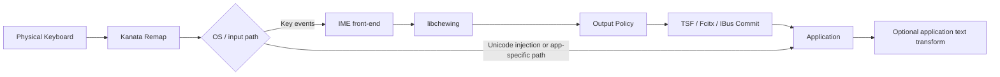
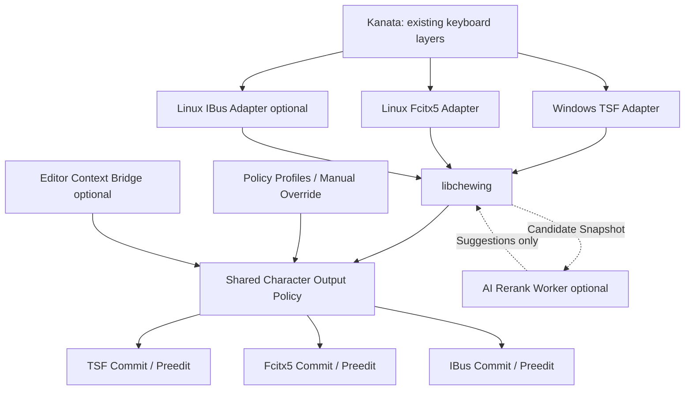
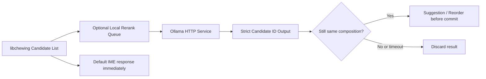

# 新酷音 × Kanata：跨平台 ASCII-first／全形標點／AI 語意輸入法開發研究文件

> **文件類型**：原始碼研究、架構設計、Antigravity 開發交接規格  
> **版本**：研究草案 v0.1｜2026-10-22  
> **目標平台**：Windows 10/11、Linux（Fcitx5 優先；IBus 次之）；macOS 預留延伸  
> **主要語言**：台灣正體中文；注音鍵盤  
> **現有工作基準**：新酷音／libchewing + 使用者既有 `kanata.kbd`  
> **專案原則**：保留既有打字習慣、零雲端依賴、最小侵入、可回退、先確定性後 AI  
> **本篇不含**：實測驗證結論、Benchmark 數據、相容性矩陣、QA 案例、測試結果、正式驗收報告；均另立驗證文件。

---

## 0. 提供給 Antigravity 的啟動指令（可直接貼上）

請以本文件作為開發工作的需求來源，**先做原始碼盤點與技術設計，再進入最小可行修改**。請遵守：

1. 建立自己的 Git 工作區和功能分支，保存上游來源、remote、版本、commit SHA；嚴禁直接改系統已安裝的輸入法。
2. 分別取得 `libchewing`、`windows-chewing-tsf`、`fcitx5-chewing` 原始碼；若確實使用 IBus 才取得 `ibus-chewing`；保留其原有授權聲明與 Git 歷史。上游以 Codeberg 為準；GitHub 鏡像可作閱讀備援。
3. 不先重寫注音輸入法，不先導入 Ollama。優先完成原始碼路徑、字元流向、IME 控制邊界與設計報告，再開發**可停用的 ASCII-first 標點策略**。
4. 保留原版新酷音所有既有中文組字功能與選字習慣；保留正式文件用的全形輸入能力；保留 Kanata 自訂層，不擅自覆寫。
5. Windows 和 Linux 原生接入分開實作，跨平台規則盡可能共用；不要把 Windows TSF 的 COM 邏輯硬塞進 `libchewing`。
6. 明確區別按鍵事件、Kanata 的 Unicode 輸入、libchewing 組字、平台 commit 與應用程式修改。**若文字已繞過 IME 或被應用程式事後改寫，不可聲稱 IME 可以攔截。**
7. 設計中預留 Neovim Mode Bridge、Terminal guard 與 Ollama reranker，但所有 AI 都必須是可選、非同步、失效可回退、不得改寫已提交文字。
8. 第一輪交付：`UPSTREAM_INVENTORY.md`、`CODE_PATH_MAP.md`、`ARCHITECTURE_DECISIONS.md`、`PATCH_PLAN.md`、一組獨立配置格式草案。若已確定技術路徑，再以小範圍 PR/commit 實作。請不要在此交付實際測試結果，另篇處理。

**範圍警示**：此文件是已查閱官方文件／公開原始碼後建立的研究規格，尚未在使用者 Windows／Linux 裝置上編譯或驗證。上游 API 與資料夾可能因後續版本改變，務必以實際 checkout 為準。

---

## 1. 專案動機、問題定義與成品定位

### 1.1 使用者目前的實際工作流

使用者已長期在 **Windows 與 Linux 使用新酷音**，並透過 **Kanata** 改鍵：

- 需要高頻輸入 Markdown、程式碼、Git、命令列、技術術語；希望 `[]{}():;<>`、反引號、底線、管線等通常為 **ASCII 半形**，不必手動反覆切換全形／半形。
- 在書信、一般中文段落或正式電子郵件中，仍須能**主動使用中文全形標點**（如 `，。：「」`）與既有全形模式；不可一刀切移除全形。
- 需要在 Vim/Neovim Normal、Insert、Visual、Command-line 不同模式下保留命令語意；不可把 `dd`、`ciw`、`:wq` 解成注音或由 AI 自動修改。
- 希望日後以 **Windows + Linux 共用核心**，並可能延伸 macOS；在 4 GB 以下 AI 推論記憶體預算內，使用 Ollama 本地小模型處理中英混寫、上下文選字和領域術語。
- 已知部分應用程式可能攔截或替換 ASCII／Unicode。此問題不能在尚未分層釐清之前，直接歸責於某個單一輸入法元件。

### 1.2 此階段要交付什麼

**本期交付的應是輸入法修改研究與可維護的工程設計，非「從頭做新輸入法」。** 目標：

- 建立開源原始碼基線與修改點。
- 設計 ASCII-first/Fullwidth 兼容的符號政策（Character Output Policy）。
- 設計設定檔、設定切換、程式碼／Markdown／Email 等使用情境 profile。
- Windows/Linux adapter 盡量只管平台事件、preedit、commit；策略共用。
- 保留上游更新能力，盡量少動 libchewing 詞庫與語言模型。
- 預留擴充模組，不把 Ollama 放進輸入事件的同步關鍵路徑。

### 1.3 非目標／禁止設計

- 不透過全域鍵盤攔截、全域剪貼簿掃描或持續紀錄打字內容來達成目標。
- 不以「偵測 Email 軟體就全部輸出全形英文字母」當作預設；電子郵件地址、網址、程式碼片段必須保持 ASCII。使用者需要的通常是**中文書信標點**，應做可配置、可手動切換的政策。
- 不盲目把所有輸出套 NFKC；NFKC 可能更改原本合法的全形文字及相容字元。
- 不修改已提交至應用程式的文字、不強制 AI 改寫、不讓模型攔截 Vim 控制按鍵。
- 不以「Kanata 已送出 U+003A」直接推論「新酷音必定收到 ':'」；兩者之間還有注入與應用程式框架行為。
- 不在研發前期覆蓋系統正式輸入法安裝或使用者詞庫。

---

## 2. 上游專案總覽：核心與平台前端是不同產品

| 專案 | 角色 | 技術／框架 | 授權重點 | 主要用途 |
| --- | --- | --- | --- | --- |
| `chewing/libchewing` | 注音組字引擎、候選字／詞、標點與模式 | C 相容 API；現代版本包含 Rust 實作／建置能力 | LGPL-2.1-or-later 為主，個別檔案以原始授權為準 | 穩定核心，盡可能不動 |
| `chewing/windows-chewing-tsf` | Windows IME 接入 | Windows Text Services Framework (TSF)，Rust/C++/安裝封裝等依版本而定 | GPL-3.0-or-later | Windows 字元事件與提交接入 |
| `fcitx/fcitx5-chewing` | Linux Fcitx5 新酷音接入 | C++／Fcitx5 API／CMake | LGPL-2.1-or-later（以工作樹檔案 SPDX 為準） | Linux 第一優先前端 |
| `chewing/ibus-chewing` | Linux IBus 新酷音接入 | C／GLib／IBus／Meson | GPL-2.0（見官方倉庫） | Linux 替代前端 |
| `jtroo/kanata` | 鍵盤重新映射 | Rust／OS 特定鍵盤輸入層 | 依原倉庫授權文件 | 保留現有配置，不重造 |
| `ollama/ollama` | 可選本地 LLM 服務 | HTTP API；本機推論 | 模型各自授權獨立 | 後續非同步 rerank |

**上游儲存庫**：

- libchewing 主線：https://codeberg.org/chewing/libchewing ；閱讀鏡像：https://github.com/chewing/libchewing
- Windows TSF 主線：https://codeberg.org/chewing/windows-chewing-tsf ；閱讀鏡像：https://github.com/chewing/windows-chewing-tsf
- IBus 主線：https://codeberg.org/chewing/ibus-chewing ；閱讀鏡像：https://github.com/chewing/ibus-chewing
- Fcitx5：https://github.com/fcitx/fcitx5-chewing
- Kanata：https://github.com/jtroo/kanata

**不要將不同倉庫的授權混成一個授權**。實際整合、連結、打包、修改與發行需分別保留 copyright、LICENSE/COPYING、NOTICE、SPDX；若日後公開二進位檔，另請法律／授權負責人覆核。免費開源並不等於不必履行開源義務。

### 2.1 知識更新注意事項

- 2026 年的 libchewing 已有 0.13.x 版本；不是只能依賴舊的 0.5.x API／Makefile 教學。`chewing` Rust crate 在 docs.rs 亦有原始碼文件。
- 上游 README 的最低 Rust/CMake 條件會隨版本更新：**不得在規格書硬編死某一工具版本為永遠適用**；checkout 後閱讀 `README.md`、`CMakePresets.json`、`Cargo.toml`、`.github`/`.forgejo` CI 再決定。
- Windows TSF 倉庫既有專案 README 仍使用歷史名稱 `chewing_tip` 等描述，但倉庫現有 `crates/`、`tip/`、`xtask/` 等目錄。應**以目前 checkout 的檔案樹與 `Cargo.toml` workspace 為準**，不可對照舊文章盲改不存在的檔案。

---

## 3. 使用者 Kanata 原始配置盤點（已直接閱讀上傳的 `kanata.kbd`）

> 原始檔作為參考附件 `kanata.original.kbd`。**不得直接覆寫**；未經說明，不得修改使用者已建立的肌肉記憶。

### 3.1 目前存在的映射

| 配置要素 | 原始設定摘要 | 工程意義 |
| --- | --- | --- |
| `process-unmapped-keys yes` | 未列出按鍵也由 Kanata 處理 | 上游事件／虛擬鍵與實體鍵的對應需要區分 |
| `caps-dance` | `(tap-dance 100 ((macro M-spc) caps))` | 點按送 `Meta+Space`、連擊送 Caps；OS 的 IME 快捷鍵是否相同取決於使用者系統配置 |
| `capsww` | `(tap-hold 120 180 @caps-dance lctrl)` | 長按 Caps 是 Ctrl；Vim Ctrl 組合鍵不得被 IME 吞掉 |
| `num` | `(tap-hold 120 180 f (layer-toggle number))` | `f` 短按為 f，長按開啟 number layer；按鍵順序與超時機制不可擅改 |
| `number` layer | 包含 `@ulp`、`@urb`、`@u_`、`@u\``、`@ucln` 等 | 意圖是高效率輸入 Markdown／程式語法 |
| Unicode aliases | 如 `(unicode u+005b)`、`(unicode u+003a)` | 希望明確要求 ASCII 字元，而不是依賴中文標點鍵位 |
| 數字與運算 | `kp1`…`kp0`、`kp+`、`kp-`、`kp.` 等 | 這是**小鍵盤事件**，與直接 Unicode 注入路徑不同 |
| 原有 `markdown` layer | 寫在註解中，未啟用 | 不要憑舊註解推測實際功能 |

### 3.2 關鍵符號別名

```text
@ulb  = [  U+005B        @urb  = ]  U+005D
@ulc  = {  U+007B        @urc  = }  U+007D
@ulp  = (  U+0028        @urp  = )  U+0029
@ucln = :  U+003A        @usme = ;  U+003B
@udq  = "  U+0022        @uqt  = '  U+0027
@u_   = _  U+005F        @u|   = |  U+007C
@ult  = <  U+003C        @ugt  = >  U+003E
@u`   = `  U+0060        @uqst = ?  U+003F
```

**原始配置特別注意**：

1. Kanata 官方說明 `unicode` 動作**並非所有應用程式都可正常接收**；它未必等同於標準鍵盤按鍵事件或 IME `commitString`。
2. Linux 的 Unicode 輸入可能依賴 `Ctrl+Shift+U`、輸入 hex、Enter 的機制；在 Terminal、非 GTK 應用、某些 Wayland/輸入框中可能不同。
3. 數字層混用 `kp` 事件與 Unicode，因此有可能走兩條不同輸入管線。**不能將問題一律歸因於 ASCII code 被「劫持」**。
4. `M-spc` 不應翻譯成跨平台保證的「Win+Space」。在 Windows 是 Win/Meta，在 Linux 可能映射至 Super，具體桌面環境輸入法切換快捷鍵不同。
5. 原始配置有例如同一 Unicode alias 可能在不同按鍵位置重複使用的映射，屬個人快捷配置，不應當成自動修正項目。

---

## 4. 字元如何走到應用程式：先理解邊界

### 4.1 一般鍵盤輸入路徑（概念圖）



箭頭表示**可能路徑**，並非所有平台或 Kanata 動作都經過所有節點。最重要的三個控制層：

1. **字元來源**：實體鍵盤／Kanata 虛擬按鍵／Unicode 直接輸入。
2. **IME 可控範圍**：攔截 key event、composition/preedit、commit string。
3. **應用程式自己的處理**：自動取代、智慧標點、富文字編輯器 Markdown 規則等。IME **無權保證**覆寫這些後處理。

### 4.2 ASCII 與 Unicode 的正確概念

ASCII 是 U+0000–U+007F 字元集合的編碼觀念。`:` (`U+003A`) 與 `：` (`U+FF1A`) 是**不同 Unicode 碼點**，並非同一個值在程式內被「顯示寬度改變」。同理：

| ASCII | Code point | 全形／中文常見對應 | Code point | 是否可盲目互換 |
| --- | --- | --- | --- | --- |
| `:` | U+003A | `：` | U+FF1A | 不可；程式語法需 `:` |
| `,` | U+002C | `，` | U+FF0C | 不可；程式參數／CSV 需 `,` |
| `.` | U+002E | `。` 或 `．` | U+3002 / U+FF0E | 對應**不是唯一** |
| `(` | U+0028 | `（` | U+FF08 | 不可；程式括號需 ASCII |
| `)` | U+0029 | `）` | U+FF09 | 不可 |
| `[` | U+005B | `［` | U+FF3B | 不可 |
| `]` | U+005D | `］` | U+FF3D | 不可 |
| `"` | U+0022 | `「」` / `“”` | U+300C/300D / U+201C/201D | 語言／配對／字型不同，無法簡單一對一 |
| `'` | U+0027 | `‘’` | U+2018 / U+2019 | 同上 |
| `\` | U+005C | `＼` | U+FF3C | 路徑／escape 不可變更 |
| `@` | U+0040 | `＠` | U+FF20 | Email 地址必須保留 ASCII |

**建議不使用全域 Unicode 正規化來達成「半形優先」**。要以字元類型、來源、上下文、使用者明確切換狀態決定。

### 4.3 三種最容易被混淆的輸出

- **Raw Key**：物理／虛擬鍵值，可能含 modifiers、layout，並不代表最終字元。
- **IME Commit**：輸入法完成組字，送到應用的 UTF-8／UTF-16 文字；可在 IME 內政策處理，但必須避開中文組字內容不必要的變更。
- **Direct Unicode/OS Text Injection**：未必通過新酷音。若走此路徑，修改 libchewing 的標點映射可能完全沒效果。

### 4.4 本專案控制能力分級

| 來源／情境 | 能否由本專案控制 | 合理方案 |
| --- | --- | --- |
| libchewing 自己產生的標點 | 原則上可以 | 修改引擎配置或策略層 |
| Fcitx5 接收到的 KeyEvent | 通常可以在前端內處理 | 進入前適用 passthrough policy |
| Windows TSF 接收到的按鍵與 composition | 在 TSF 服務權限／框架範圍內 | 遵守 TSF composition 生命週期 |
| Kanata `unicode` 直接提交文字 | 不保證能攔截 | Kanata 保留原樣；必要時提供 profile 切換協定 |
| 應用程式收到文字後改寫 | 不能一般性保證攔截 | 與特定應用整合／停用其自動取代設定 |
| 管理員／UAC／登入畫面／遊戲 | 視平台安全隔離而定 | 保持系統原有輸入法與保守 fallback |

---

## 5. 原始碼的實際改造切入點

### 5.1 libchewing 引擎：理解 API，先不要直接加 AI

官方說明了中文 Editing Mode、Half/Full Shape sub-mode、Temporary English sub-mode，以及預設的 Shift+Space 全／半形切換。和本題有直接關係的 API 名稱／函式可從官方 C 介面與 Fcitx5 前端看到：

- `chewing_handle_Default(ctx, ...)`：一般鍵盤輸入交給新酷音引擎。
- `chewing_handle_Space(ctx)`、`chewing_handle_ShiftSpace(ctx)`：空白／全半形模式相關按鍵。
- `chewing_set_easySymbolInput(ctx, ...)`：簡易符號模式設定（行為與前端設定相關）。
- `chewing_commit_Check(ctx)`：是否存在已完成輸出。
- `safeChewing_commit_String(ctx)`：Fcitx5 wrapper 使用的安全文字取得函式／封裝；不要假設這是 libchewing 原生 C ABI 名稱。
- 引擎另有 buffer、candidate、preedit、keystroke absorb/ignore 等狀態，需要清楚維護。

**源碼閱讀順序**：讀 `README` → `include/` 公開標頭 → CMake/Cargo 建置組態 → symbols／mode／output 相關內部實作 → wrapper 與用戶詞庫機制。檔名依 checkout 版本確認。

### 5.2 Linux：Fcitx5 目前可見的精確程式入口

`fcitx5-chewing/src/eim.cpp` 的 `ChewingEngine::keyEvent(...)` 可見：

- 過濾 key release，處理候選列表。
- 按 key event 分流到 `chewing_handle_Space`、`chewing_handle_Tab`、`chewing_handle_Default`、Backspace、Escape、方向鍵等。
- 在 Shift 情境設定 `chewing_set_easySymbolInput`。
- 在 `chewing_commit_Check(ctx)` 成立時呼叫 `ic->commitString(safeChewing_commit_String(ctx))`。
- `filterKey(...)` 處理額外 passthrough 與 buffer flushing。

**第一改造接點候選**：

```cpp
// 只為說明接點的「概念偽碼」，不是可直接套用的 patch。
if (chewing_commit_Check(ctx)) {
    auto committed = safeChewing_commit_String(ctx);
    auto output = policy_engine.transformCommit(committed, current_context);
    ic->commitString(output);
}
```

注意：這只保證**經過 commit 的文字**可被處理，不能處理 passthrough、已被其他程式注入的文字；且必須避免改變中文詞組、候選字和學習機制。真正實作需兼顧上游所有 commit 路徑與候選字提交分支，不能只修改一個 `commitString` 位置。

### 5.3 Linux：IBus

IBus-Chewing 是另一個獨立前端。其 BUILD/INSTALL 文件目前使用 Meson，依賴 IBus、GLib、GTK4、libadwaita 與 libchewing。不要把 Fcitx5 的 C++ 對象模型硬貼至 IBus C 程式碼；應以同一政策格式和獨立 adapter 整合。

### 5.4 Windows：TSF 不是一般的鍵盤 hook

Windows Chewing TSF 專案提供 `chewing_tip`／註冊與偏好設定／安裝器等元件，近期倉庫有 Rust workspace、`tip/`、`xtask/` 等結構。Windows Text Services Framework 的編輯順序涉及 composition 的建立、文字更新、終止、焦點切換、edit sessions 與 GUI 候選字。應依 Microsoft 文件操作：

- 建立／管理 composition：`ITfContextComposition::StartComposition`、`ITfComposition`。
- 結束 composition：`ITfComposition::EndComposition`。
- 應用端能收到 composition lifecycle callback，不可在任意執行緒直接改寫已提交結果。
- 同步修改／非同步修改 edit session、失焦／取消／快捷鍵切換都需遵守 TSF 規範。

**Windows 改造候選**：從 Windows TSF event dispatch、composition commit、全／半形設定、preferences GUI 路徑找插點；**不要一開始寫全域 WH_KEYBOARD_LL 攔截器**，因為它會與 Kanata、其他 hook、權限邊界及其他 IME 衝突。

### 5.5 Windows 端如何兼容 Kanata

- 先沿用原本的 `Meta+Space`、Caps tap-hold、number layer。
- 新輸入法不得佔用 `Ctrl`/`Alt`/`Win` 常用快捷鍵；確有衝突時提供可配置排除規則。
- 新增標點策略快捷鍵應可設為**目前無佔用的獨立快捷鍵**，而非寫死 `Shift+Space`。預設也應尊重新酷音原生切換。
- 不假定 TSF 一定看得到由 Kanata `unicode` action 注入的每個 Unicode 字元。

---

## 6. 建議的總體架構：核心小改、平台適配、可選 AI



此圖展示**理想模組邊界**，不是宣稱三個前端的既有 API 完全相同。

### 6.1 優先採行的改造策略

**策略 A：Adapter-first（建議起手）**

- Fcitx5/TSF 前端各自加很薄的 policy adapter。
- libchewing 不需新增專案特定的多種新模式；降低上游重同步成本。
- 缺點：可能漏掉某些引擎自行產生的標點或跨前端行為不一致。

**策略 B：libchewing Core Extension（必要時升級）**

- 若某個行為只能在產生候選字前決定（例如符號候選與中英混合斷詞），才修改 libchewing C/Rust 內部。
- 優點：多前端共用語意；缺點：維護成本、ABI 穩定性、上游合併難度較高。

**策略 C：修改 Kanata（原則上不是第一步）**

- 若文字從未經 IME，直接從 Kanata 注入至應用，應另外思考在 Kanata 層切換／避免使用 Unicode 注入，或針對特定場景使用 IME 可識別的 event。
- 不應為繞過應用改寫而建立全域鍵盤記錄器。

### 6.2 共用策略模組的語言選擇

**建議先做一個非常小的 C ABI、純同步且無系統依賴的符號政策庫**，實作可選 C11 或 Rust `cdylib/staticlib`（依實際整合成本定案）。理由：

- Windows TSF 與 Linux Fcitx5／IBus 皆有 C/C++/Rust 不同整合方式；C ABI 比共享平台 GUI 邏輯更容易。
- Policy 只處理配置、模式、字元類型與可明確界定的少量文本；不直接呼叫 TSF、Fcitx5、Ollama。
- 配置可以先用 TOML/JSON，由平台 adapter 讀取；policy 核心只接收 parsed options。
- 若第一階段只有 Fcitx5，一開始也可在 Linux 前端封裝接口，不必過早抽象、製造大型跨平台框架。

---

## 7. 輸出策略（Character Output Policy）詳細設計

### 7.1 不要只有「全形／半形」一個 bool

建議將下列概念分離：

1. **字母數字寬度**：`ascii`、`fullwidth-on-request`。
2. **ASCII 標點**：`literal-ascii`、`traditional-zh-punctuation`、`follow-upstream`。
3. **中文字詞組字**：交給 libchewing，不要以 ASCII 標點邏輯改寫。
4. **模式**：`normal`、`markdown`、`code`、`formal`、`raw-command`、`manual-fullwidth`。
5. **override 強度**：使用者手動設定 > 編輯器準確回報 > 應用程式 profile > 啟發式 > 預設；涉及密碼／命令時安全規則最高。

### 7.2 建議 Profiles

| Profile | 使用情境 | ASCII 符號 | 中文標點 | 英文字母／數字 | AI |
| --- | --- | --- | --- | --- | --- |
| `default` | 一般混合輸入 | 預設保留，按上游有意義的標點規則 | 明確選用時保留 | ASCII | 可選 |
| `markdown` | Obsidian、Markdown 編輯區 | 強制保留使用者明確送入的 ASCII | 手動選取 `，。` | ASCII | 可選，低干預 |
| `code` | VS Code code editor、IDE | literal/pass-through，絕不隱式替換 | 只在明確中文輸入時 | ASCII | 預設不改碼 |
| `formal` | Email 正文、正式文件 | 可選轉中文標點；URL/address/code 排除 | 優先中文標點／保留既有全形 | 英數預設仍 ASCII | 可選 |
| `raw-command` | Vim Normal／Command、Shell 指令 | 完整 passthrough | 不介入 | ASCII | 關閉 |
| `manual-fullwidth` | 使用者明確要求全形字母數字 | 依既有全形規則 | 依既有全形規則 | 可轉全形 | 關閉 |

**設計特別提示**：Email 正文的「全形需求」要保留，但 Email address (`name@example.com`)、網址、API 參數、程式碼塊都要保留 ASCII。請不要預設「在 Outlook/Gmail 就強制所有 ASCII 變全形」。

### 7.3 最小可行規則

```text
rule order (highest wins):
  0. secure input / unknown sensitive field -> no capture, no AI, system-safe path
  1. raw command mode -> pass key as-is, do not open composition
  2. explicit manual user override -> obey policy without overwriting Chinese buffer
  3. trusted editor mode says code/markdown -> preserve literal ASCII punctuation
  4. selected formal profile -> Chinese punctuation allowed; protect URLs/emails/code spans
  5. normal text -> upstream behavior, but keep deliberate ASCII mappings intact where observable
```

**可控範圍限制**：若政策引擎只接收到 `commit`，就只能轉換自己的 commit，不能保證某個 Kanata 直送字元一定經過此規則。

### 7.4 需要被保護的標記

建議以下語法一律 **不做自動寬度轉換**：

- URL、Email Address、檔案路徑（尤其 Windows `C:\...`）。
- Markdown：反引號、code fence、`#` 標題、`-` 列表、`[]()` link、`|` 表格、`>` 引言。
- Python/C/C++/Rust/JavaScript：所有運算子、括號、分號、冒號、引號、反斜線。
- Shell：`|`、`>`、`<`、`&`、`$`、`\`、引號、旗標 `--`。
- Vim 命令 `:wq`、`:set`、`/pattern`、`?pattern`、巨集紀錄與 register 操作。

**不建議以大量 Regex 即時掃描整篇內容**；可採短窗口、可預期行為的有限狀態規則，未知情況採不轉換。

---

## 8. 共用政策介面（設計草案，非既有上游 API）

### 8.1 定義必要輸入

```c
/* Proposal only: not an existing libchewing header */

typedef enum {
    IME_PROFILE_DEFAULT,
    IME_PROFILE_MARKDOWN,
    IME_PROFILE_CODE,
    IME_PROFILE_FORMAL,
    IME_PROFILE_RAW_COMMAND,
    IME_PROFILE_MANUAL_FULLWIDTH
} ime_profile_t;

typedef enum {
    IME_INPUT_KEY_EVENT,
    IME_INPUT_ENGINE_COMMIT,
    IME_INPUT_EXTERNAL_TEXT,
    IME_INPUT_ORIGIN_UNKNOWN
} ime_origin_t;

typedef struct {
    ime_profile_t profile;
    ime_origin_t origin;
    bool secure_field;
    bool has_active_preedit;
    bool explicit_user_override;
} ime_policy_context_t;

typedef enum {
    IME_ACTION_PASSTHROUGH,
    IME_ACTION_ENGINE,
    IME_ACTION_TRANSFORM_COMMIT
} ime_action_t;
```

`ime_origin_t` 不應假裝 OS 一定能知道文字是不是 Kanata 輸入；它只是用來標記**已知的事件路徑**，未知來源應為 unknown。

### 8.2 處理流程

```text
handle_key(key_event, editor_context, profile):
    if secure_field:
        return pass_through_without_AI
    if editor_context.trusted and editor_context.mode in RAW_MODES:
        return pass_through_to_application
    if key_event.is_system_shortcut:
        return pass_through_to_application
    return existing_IME_key_dispatch

handle_engine_commit(text_utf8, context):
    if secure_field or context.profile == RAW_COMMAND:
        return text_utf8
    if text_is_chinese_candidate_or_protected_text:
        return text_utf8
    return transform_only_explicitly_targeted_punctuation(text_utf8)
```

### 8.3 API 與事件設計原則

- 分離 `KeyEvent`／`Composition`／`CommitText`／`InputContextChanged`／`ProfileChanged`。
- 所有文字內部使用 UTF-8；Windows 邊界轉 UTF-16，保證不破壞 surrogate pairs；不以 byte index 移動 Unicode 游標。
- UI 候選字與輸出字串顯示應一致，避免候選視窗寫 `:`，commit 卻輸出 `：`，除非 UI 明確說明政策。
- Profile 可本機靜態儲存，並在使用者切換時回報目前狀態。
- Policy 不能卡住 IME 主執行緒、不能阻塞前端事件迴圈。
- 無法判斷完整上下文時，採不轉換、可修正、尊重使用者明確輸入。

---

## 9. 狀態管理：不要讓切換把未提交中文弄丟

### 9.1 建議分離的狀態

```text
Keyboard layer (Kanata): default | number | future others
IME language state: Chinese | temporary English
IME shape state: Half | Full (upstream capability)
Output policy: default | markdown | code | formal | raw-command | manual-fullwidth
Composition state: idle | preedit | candidate_selection | committing
Editor mode: unknown | normal | insert | visual | command | terminal
AI state: disabled | idle | pending | suggestion_ready
```

### 9.2 狀態轉換的責任

- Kanata 管 `tap-hold`、`tap-dance`、按鍵映射，**不作中文語意判斷**。
- libchewing 管注音 buffer、候選字、詞頻與既有輸入法核心。
- TSF／Fcitx5／IBus 管 OS 焦點、composition、commit、快捷鍵與與 GUI 整合。
- Policy 管符號寬度、profile、可明確界定的輸出條件。
- Neovim Bridge 管準確編輯器模式回報；AI 只能提供選字排序建議。

### 9.3 焦點與模式切換的語意

當 `Neovim Insert -> Normal`：

1. Bridge 送出 editor mode changed。
2. Adapter 根據上游狀態與使用者 policy，選擇**既有明確的 commit/cancel 行為**；不得默默遺失已輸入的中文。
3. Normal 模式中的 `h/j/k/l`、`dd`、`ciw` 應由編輯器接收。
4. 再進入 Insert 才按使用者偏好恢復輸入法。

**尤其不能在 `Esc` 每次按下時直接無條件清空上游 buffer**；這會毀損未提交內容。

---

## 10. Vim / Neovim / Terminal 模式感知

### 10.1 不靠猜 `Esc` 來決定 Vim 模式

當 Terminal 內執行 Neovim、tmux、SSH、多層 terminal emulator 時，桌面輸入法不一定知道遠端程式內部模式。只靠按到 `Esc`、`i`、`:` 反推，會被 escape sequence、鍵位映射、terminal 輸入延遲影響。

### 10.2 Neovim Bridge 的最小設計

官方 Neovim `ModeChanged` autocmd 可提供 `old_mode:new_mode`；`nvim_get_mode()` 亦可查詢模式。設計一個用戶空間 Lua plugin：

```lua
-- Design sketch; intentionally no live socket implementation here.
local group = vim.api.nvim_create_augroup("ChewingContext", { clear = true })
vim.api.nvim_create_autocmd("ModeChanged", {
  group = group,
  callback = function()
    local mode = vim.api.nvim_get_mode().mode
    -- send locally to context bridge asynchronously, without typing into buffer
    -- send_context({ editor = "nvim", mode = mode, filetype = vim.bo.filetype })
  end,
})
```

**IPC 建議**：使用本機 Unix domain socket 或 Windows named pipe，或一個跨平台本機 loopback channel；附 session id、來源 process、聚焦狀態、sequence number、過期時間。先做可關閉的 bridge，避免無意識洩漏程式碼或編輯內容。

### 10.3 Terminal 與遠端作業

- Shell prompt、Neovim Command-Line 與 terminal raw mode 是不同概念，不能合併成「終端機永遠英文」。
- `git commit -m "修正錯字"`：指令骨架需要 ASCII，但引號中文字串可用新酷音。
- 遠端 SSH Neovim 模式必須有**遠端回報到本機的可驗證訊號**，不能假裝能透過本機視窗標題準確偵測；應將實作列為後續階段。
- 若 bridge 中斷，應保守停用 editor-aware 自動切換，保留手動中文輸入能力。
- 不自動修改 `Ctrl-C`、`Ctrl-Z`、`Ctrl-[`、`Esc`、`Alt` 等原始快捷鍵語意。

---

## 11. 本機 AI：是候選字「重排序器」，不是文字接管者

### 11.1 架構原則

AI 只能選擇／排序**新酷音已產生的合理候選**。原本 libchewing 的組字與提交維持決定性的、同步可用的核心。若要實現完整英文詞綴偵測與中英混打，這是後續獨立研究，不等於用 LLM 為所有按鍵生成任意文字。



### 11.2 模型候選（目前 Ollama 型錄的下載大小）

| 模型 tag | 官方頁顯示權重大小 | 定位 |
| --- | ---: | --- |
| `qwen3:0.6b` | 約 523 MB | 第一個可行性研究與低階設備 |
| `qwen3:1.7b` | 約 1.4 GB | 首選語意候選排序 |
| `qwen3:4b` | 約 2.5 GB | 更高品質的比較候選，能否低於 4 GB **需另篇實測** |

**重要**：「模型檔」≠ 執行中 GPU VRAM；還有 KV cache、上下文長度、runtime、CPU offload、Apple unified memory 等額外成本。不能從下載檔大小宣稱 4GB GPU 達標。Windows dGPU 與 Apple Silicon 統一記憶體應分開描述與管理。

### 11.3 Ollama 介面建議

官方 `/api/generate`／`/api/chat` 支援 `format` JSON、`options`、`stream`、`keep_alive`。建議只回傳候選 ID，不能讓模型提供任意改寫後的文字；prompt 可以要求不推理長篇、只選排序。

```json
{
  "model": "qwen3:0.6b",
  "stream": false,
  "format": "json",
  "options": { "temperature": 0, "num_ctx": 512 },
  "prompt": "在以下候選中選出最適合的候選 ID，僅輸出 JSON: {\"id\":\"...\"}。候選: [{\"id\":\"c1\",\"text\":\"...\"}]"
}
```

這是**概念請求樣板**；`num_ctx` 等參數是否滿足效能需求、模型是否可靠遵守結構格式，應另篇測量。使用小型分類器／n-gram／詞典 cache 可能比每次呼叫 LLM 更符合輸入法時延要求。

### 11.4 防止輸入法變慢的硬條件（設計而非已驗證數據）

- 不得「每按一鍵」都同步呼叫 LLM。
- 僅在候選字語意歧義、中文／英文判別不確定時考慮觸發。
- 輸入事件不可等待模型回應；模型結果如果落後於 buffer 版本，直接丟棄。
- 模型處理離線、本機 loopback；關閉雲端 fallback。
- LLM crash、OOM、Ollama 未啟動或更新失敗時，基本新酷音輸入仍應可用。
- 預設不傳送密碼欄位、網址列秘密、token、命令列機密、任何已提交全文或跨應用程式歷史。

### 11.5 建議抽象的 Reranker 接口

```text
CandidateRerankRequest:
  request_id          opaque string
  composition_version monotonic int
  profile             enum
  context_hint        short sanitized snippet, optional
  candidates          [{id, text, existing_score}]

CandidateRerankResponse:
  request_id
  composition_version
  ranked_candidate_ids  list of IDs already present in request
  model_info            optional debug-only metadata
```

嚴禁 AI 創造 request 不在的 candidate ID，也不許修改已 commit 的內容。

---

## 12. 使用者偏好設定與配置草案

### 12.1 原則

- 不需每次打字手動切換；profile 切換要少、可預測且可快速回復。
- `formal` 與 `manual-fullwidth` 明確可啟用；不能用猜測強制覆蓋文字。
- Windows 與 Linux 同用一份純資料規格，各自在平台層讀取。
- 新增「目前 profile」視覺提示，不必改 Kanata 所有 alias。

### 12.2 建議 TOML（草案）

```toml
schema_version = 1
profile_default = "default"
manual_profile_hotkey = "unassigned"  # 避免與 Kanata / OS 衝突

[profiles.default]
latin_width = "ascii"
punctuation = "upstream_with_explicit_ascii_priority"
ai_rerank = false

[profiles.markdown]
latin_width = "ascii"
punctuation = "literal_ascii"
ai_rerank = false

[profiles.code]
latin_width = "ascii"
punctuation = "literal_ascii"
ai_rerank = false

[profiles.formal]
latin_width = "ascii"
punctuation = "traditional_chinese_when_explicit"
ai_rerank = false

[profiles.manual_fullwidth]
latin_width = "fullwidth"
punctuation = "follow_upstream_fullwidth"
ai_rerank = false

[profiles.raw_command]
latin_width = "ascii"
punctuation = "passthrough"
ai_rerank = false

[context]
trust_editor_bridge = false
fallback_profile = "default"

[ai]
enabled = false
provider = "ollama"
model = "qwen3:0.6b"
endpoint = "http://127.0.0.1:11434"
allow_network_non_loopback = false
```

**說明**：上述 profile 名稱、欄位和值完全是本案新設計的草案，不是上游新酷音／Kanata 已支援的設定鍵，請勿直接貼入上游配置檔期待生效。

### 12.3 Profile 選擇優先序

```text
security constraints
    > explicit user override
    > trusted live editor context
    > per-app user rule
    > default
```

不要用「看到某個網站是 Gmail」自動判定整個瀏覽器為 Email 全形模式。可按使用者手動開啟，或未來在具明確焦點資訊的 editor bridge 內做精準區分。

---

## 13. Windows 開發環境與建置研究路線

### 13.1 原始來源

Windows TSF 官方 README 已列：

- **MSVC Windows 原生建置**：Visual Studio 2022 Build Tools、Node.js、Rust。
- **MSYS2／MinGW**：Windows 交叉建置途徑。
- **Fedora MinGW-W64**：Linux 交叉建置途徑。
- 使用 cargo `xtask` 建置與打包安裝器。

### 13.2 原生建置命令（官方文件摘錄並整理）

```powershell
# 在 Windows 安裝 Git、VS 2022 Build Tools、Rust、Node.js 等所需依賴。
# 實際 CLI / compiler 必須使用專案README與 checkout 預設。
git clone https://codeberg.org/chewing/windows-chewing-tsf.git
cd windows-chewing-tsf

git status
git rev-parse HEAD
cargo xtask build-installer --target msvc --release
cargo xtask download-components
cargo xtask package-installer
```

> 官方 xtask 流程會下載打包相關元件；請先在乾淨研發環境使用，勿自動覆蓋正在使用的系統 IME。若上游使用 git submodule，也須先依實際 `.gitmodules` 補齊。

### 13.3 工程注意事項

- Windows TSF COM registration、ClassID／profile ID、installer 與卸載功能應避免撞名原版正式新酷音。
- 建議研究獨立的測試 IME 名稱與 GUID，便於與官方版本並存；具體註冊實作由 TSF 專案導出，不要複製 GUID。
- 同時考慮 x64、ARM64、UWP/Win32、不同權限級別、secure desktop；不能假設所有程式都能用同一 IME entrypoint。
- 簽章與發行是後續獨立議題；不要直接冒用上游 SignPath 簽章身分。
- 維持使用者詞庫與配置檔分離，避免不慎覆寫既有資料。

---

## 14. Linux：Fcitx5 優先與 IBus 備案

### 14.1 Fcitx5

Fcitx5 Chewing 是相對薄的前端，原始碼中的 `src/eim.cpp` 直接提供按鍵事件、引擎呼叫與提交字串流程，適合先研究。

典型來源建置：

```bash
git clone https://github.com/fcitx/fcitx5-chewing.git
cd fcitx5-chewing
git rev-parse HEAD
cmake -S . -B build -DCMAKE_BUILD_TYPE=RelWithDebInfo \
  -DCMAKE_INSTALL_PREFIX="$HOME/.local"
cmake --build build --parallel
```

> 以上是 **CMake 專案的候選建置流程**，不是在特定 distro 已執行成功的紀錄。缺少 Fcitx5 開發標頭、libchewing、ECM、gettext、pkg-config 等依賴時，應按 OS 的 package manager 與 checkout 文件補齊。不要直接 `sudo make install` 蓋掉 distro 套件。

閱讀重點：

- `src/eim.cpp` 的 `ChewingEngine::keyEvent(...)`。
- `ChewingEngine::filterKey(...)`、`ChewingEngine::reset(...)`、候選字確認。
- `src/CMakeLists.txt` 所列的 library linkage 與 Fcitx5 安裝位置。
- 目前配置 UI、profile metadata、log level 的相容性。

### 14.2 IBus

官方 `ibus-chewing/INSTALL` 可見：

```bash
# 符合 Meson / GTK / IBus / libchewing 依賴後，在開發 workspace 中操作
git clone https://codeberg.org/chewing/ibus-chewing.git
cd ibus-chewing
git rev-parse HEAD
meson setup build --buildtype release --prefix "$HOME/.local"
meson compile -C build
```

其官方範例使用系統 prefix `/usr` 並在安裝後更新 GLib schema；本案先走隔離的開發環境，不要在沒有確認 XDG/IBus 搜尋路徑前保證 `$HOME/.local` 一裝即用。

### 14.3 Linux 特有問題

- X11 與 Wayland 的 text input／Input Method 協定能力不同。
- Terminal emulator 有自己的組字支援；TTY/fbterm/tmux 屬另一類問題。
- 不同 App Toolkit（GTK、Qt、Electron、Chromium、Terminal）組字行為可能有差異。
- Kanata 的 Unicode 注入依賴 OS／工具包接受程度，不能假設和 IME commit 同源。
- 若用 systemd user service 啟動 context bridge，IPC 權限及 session isolation 必須明確。

---

## 15. 核心 libchewing 自建研究路線

**官方 README 的 CMake Preset 流程示例**：

```bash
git clone https://codeberg.org/chewing/libchewing.git
cd libchewing
git submodule update --init --recursive
git rev-parse HEAD
cmake --list-presets
cmake --preset default --install-prefix "$HOME/.local"
cmake --build build

# 只有 checkout 確認包含該 preset 時才執行；依 README 決定是否使用 Rust 實作：
# cmake --preset rust-release --install-prefix "$HOME/.local"
# cmake --build build
```

注意：不同版本 README 可能列 CMake >= 3.21、>= 3.27、Rust 不同 MSRV；不在文件承諾固定值。專案使用 `libchewing-data` git submodule，若缺少資料會影響詞庫或建置。

**研究議題**：

1. 目前版 C API／ABI 是否適合作為 policy extension？
2. 是否有不修改詞庫就能控制常用半形標點的內建配置？
3. symbol table／user symbols table 是否足夠，能否只加設定而不 Fork 引擎？
4. C 與 Rust 兩種路徑的功能差異／Feature flags／版本相依性。
5. 哪些符號政策應在 input key dispatch 前做、哪些只應在 commit 後做。
6. User phrase data／個人詞庫與系統字典路徑如何保持原樣、不需遷移。

---

## 16. 開發程式碼導航（交給 Antigravity 執行）

### 16.1 先鎖定版本與目錄結構

```bash
for repo in libchewing windows-chewing-tsf fcitx5-chewing ibus-chewing; do
  if [ -d "$repo/.git" ]; then
    echo "=== $repo ==="
    git -C "$repo" remote -v
    git -C "$repo" rev-parse HEAD
    git -C "$repo" status --short
  fi
done
```

### 16.2 找出真正的符號處理路徑

```bash
# 在各自 repo 執行；大小寫與具體 API 隨版本可能變動
rg -n "full.?width|half.?width|shape|ShiftSpace|easySymbol|symbol|punctuation" .
rg -n "chewing_handle_Default|chewing_commit_Check|commitString|SetText|EndComposition" .
rg -n "keyEvent|filterKey|preedit|composition|candidate" .
rg -n "CapsLock|Shift|Ctrl|toggle|language mode|shape mode" .
rg -n "LICENSE|COPYING|SPDX-License-Identifier" .
```

### 16.3 追蹤事件流向的建議筆記模板

```text
[Source Path]
Repository:
Revision SHA:
Entrypoint function:
Received event type:
Relevant condition / mode:
libchewing call:
Commit / preedit API:
Passthrough / absorbed behavior:
Settings source:
Known limitation:
Candidate policy insertion point:
Decision (adapter / core / leave unchanged):
```

請產出**函式名稱 + 檔案相對路徑 + 具體程式碼上下文**的 Code Path Map；不要在沒有本機 checkout 時虛構檔名、行號或精確 hook。

---

## 17. 建議 Monorepo 目錄／Git 策略

```text
chewing-kanata-lab/
├── README.md
├── docs/
│   ├── 00_UPSTREAM_INVENTORY.md
│   ├── 01_CODE_PATH_MAP.md
│   ├── 02_ARCHITECTURE_DECISIONS.md
│   ├── 03_PATCH_PLAN.md
│   ├── 04_PLATFORM_WINDOWS.md
│   ├── 05_PLATFORM_LINUX.md
│   ├── 06_OUTPUT_POLICY.md
│   ├── 07_EDITOR_BRIDGE.md
│   ├── 08_AI_RERANK_DESIGN.md
│   └── 09_LICENSE_AND_DISTRIBUTION.md
├── config/
│   ├── policy.example.toml
│   └── kanata.original.kbd
├── policy-core/              # 新設共用 policy module
├── adapters/
│   ├── windows-tsf/
│   ├── fcitx5/
│   └── ibus/                # 選用
├── context-bridge/          # 後續
├── ai-rerank/               # 後續
├── scripts/
└── upstream/                 # git submodules、subtree 或明確 fork repos
```

**工作分支建議**：

```text
research/upstream-audit
feat/ascii-punctuation-policy
feat/fcitx5-policy-adapter
feat/windows-tsf-policy-adapter
feat/profile-switching
research/neovim-context-bridge
research/ollama-rerank
```

- 上游 patch 儘量拆小，一個 commit 一個意圖。
- 不把建置物件、安裝器輸出、模型權重、個人詞庫、暫存日志、敏感配置納入 Git。
- 提供 `README` 中的 upstream SHA、建置腳本版本與依賴清單，而不是提交依賴二進位。
- 使用者提供的 `kanata.kbd` 為私有習慣基準；提交前由使用者自行判斷是否公開配置。

### 17.1 建議 `.gitignore` 起點（需依上游調整）

```gitignore
# Local build / IDE
build/
out/
dist/
.cache/
.vscode/
.idea/
*.obj
*.o
*.pdb
*.log

# Rust build artifacts
**/target/

# Local personal data
user-data/
private-config/
*.sqlite
*.db
*.sqlite-wal
*.sqlite-shm

# AI assets (avoid binary/model weight commits)
models/
*.gguf
*.safetensors

# Do NOT blanket-ignore necessary lockfiles; keep Cargo.lock where upstream policy requires it.
```

---

## 18. 建議分階段的開發工項（不含測試／驗證內容）

### Stage A — 上游技術基線、架構圖、程式碼地圖

- 確定 Windows 使用的 TSF 實際倉庫與版本，Linux 實際是 Fcitx5 還是 IBus。
- 將現有 Kanata 配置視為不可變輸入條件，整理映射與功能意圖。
- 把按鍵 → frontend → libchewing → commit 的具體路徑記錄清楚。
- 找出能控制半／全形符號的**最小點**，提出 Adapter-first 與 Core Extension 優劣表。
- 產出授權與散佈依賴清單。

### Stage B — ASCII-first policy 的最小實作

- 設定結構與模式 enum。
- 把使用者明確要求的 ASCII 符號當作 literal 優先。
- 保留使用者原本 fullwidth/Chinese punctuation 功能。
- 先選定一個平台實作薄 adapter；不擅動其他平台元件。
- 原生新酷音保留為 fallback 與正式主力。

### Stage C — Windows/Linux 前端整合與操作 UI

- 將 policy 接到另一平台。
- 加入可配置快速切換與狀態顯示（不佔用 Kanata 既有快捷鍵）。
- 保存個人詞庫、設定和 profile，提供安全的還原路徑。
- 由 adapter 完成平台生命周期管理，policy 不直接呼叫 OS API。

### Stage D — Editor Context Bridge

- 加入 Neovim `ModeChanged`、filetype、buffer type 訊號。
- 定義 IPC 與可信來源；只交換模式資料，不記錄整份內容。
- 沒有 bridge 時保留手動模式；遠端 SSH 模式屬後續研究。

### Stage E — Optional AI Reranker

- 研究候選字截面與穩定的 composition version。
- 設計 Ollama API client、小模型選項與 JSON-only 輸出。
- AI 預設關閉，與 IME 主要事件回路解耦。
- 模型只重排序，不編輯已提交字元。

**順序理由**：Stage B 如果沒有確實把 ASCII 與中文全形需求區分清楚，Stage D/E 的智慧化只會讓錯誤更難控制。

---

## 19. 風險、工程決策與待研究事項

| 風險 | 性質 | 研究方針 |
| --- | --- | --- |
| Kanata Unicode 注入繞過 IME | 事件邊界限制 | 不保證攔截；必要時改用 IME 可見事件或 profile 協定 |
| 特定 App 收到後自行全形化 | 應用行為限制 | 可能只能改 App 設定／套用 App 專用 extension |
| 破壞中文組字候選 | 功能退化風險 | 優先 adapter-level，保留 libchewing 候選與 commit 語意 |
| Vim raw command 被 IME 攔截 | 高風險 UX | 以 editor mode 主動通知；未知狀態採保守 passthrough／手動選擇 |
| 上游更新與授權變動 | 維護／法遵 | pin SHA、分倉管理授權、按檔案 SPDX 清點 |
| Windows TSF install/registration 衝突 | 系統穩定性 | 獨立 GUID/註冊項與可還原安裝，不蓋掉官方版 |
| Fcitx5／IBus／Wayland 行為差異 | 平台差異 | adapter 拆分，不假裝統一所有 OS 事件 |
| AI 卡住輸入 | 效能設計風險 | 非同步、僅候選字、可關閉、保留傳統引擎 |
| 收集敏感輸入 | 隱私／安全 | 僅短期局部 context、secure fields 禁用、無雲端預設 |
| Email 寫作全形誤傷 Email address | 語境分類風險 | formal profile 不自動改網址與地址，人工優先 |

### 19.1 待 Antigravity 作出工程決策的具體問題

1. 上游 libchewing 是否已具備適合的半／全形符號配置點？能否不 Fork libchewing？
2. Windows TSF 對候選字 commit 的路徑是否集中？實際倉庫版次的提交點為何？
3. Fcitx5 是否有符號處理／commit 分支需要額外攔截？
4. 使用者正在用 Fcitx5 還是 IBus？若未定，先把 Fcitx5 當研究主線但不要暗示現場已確認。
5. 如何與已存在的 `Shift+Space`、Kanata `M-spc`、Caps tap-hold 不衝突？
6. 能否定義比「全半形」更精細的 profile，而不造成 UI 困惑？
7. 「正式電子郵件全形」應保留哪些標點與字形？實作應預設保留原生功能，待後續使用情境定義收斂。
8. 若 App 自行改寫輸入文字，需明確登記為本方案的控制範圍外，而非偷偷注入逆向替換事件。

---

## 20. Git 與交付規範（給 Antigravity）

每完成一個開發工項，要提供**文件與程式修改的對照關係**，而不是只回覆「已完成」：

```text
Work item:
Upstream source + commit SHA:
Modified repo / branch:
Modified files:
Purpose of change:
Public API/ABI impact:
Cross-platform impact:
User Kanata behavior preserved?:
Installation / rollback design:
License notes:
Unresolved upstream questions:
Next development action:
```

初期文件交付應包含下列固定題目：

- `UPSTREAM_INVENTORY.md`：source/revision/license/build-system。
- `CODE_PATH_MAP.md`：實際 key-event、preedit、commit 的函式路徑。
- `ARCHITECTURE_DECISIONS.md`：為何選 frontend policy／libchewing fork／Kanata adapter。
- `PATCH_PLAN.md`：要改哪些檔案、公開 API 差異、回退方法。
- `OUTPUT_POLICY.md`：ASCII/全形政策、profile 規格、權限與安全界線。

**禁止將實測成功、通過率、時間、VRAM 實際數據寫入本文件，除非日後另篇驗證文件有來源可引用。** 本文件的「可以」「應該」是工程可行性假說與設計方向，不是已在使用者裝置上完成的結果。

---

## 21. 官方與原始碼資料索引（供 Antigravity 延伸研讀）

> 已用公開官方或原始碼頁建立索引；主線 Codeberg 某些頁面可能在特定網路下無法直接讀取，遇到時可用 Git clone 或 GitHub 只讀鏡像。URL 為查找起點，仍須記錄實際 checkout SHA。

### A. 新酷音引擎

- [S01] libchewing 上游主線：https://codeberg.org/chewing/libchewing
- [S02] libchewing GitHub README/鏡像：https://github.com/chewing/libchewing
- [S03] libchewing 使用者模式、Shift/Space、中文組字說明：https://github.com/chewing/libchewing/blob/master/README.md
- [S04] libchewing Rust crate source/docs：https://docs.rs/crate/chewing/latest/source/README.md
- [S05] libchewing 0.13.x NEWS（2026 年變動）：https://docs.rs/crate/chewing/latest/source/NEWS

### B. Windows TSF

- [S06] Windows TSF 上游主線：https://codeberg.org/chewing/windows-chewing-tsf
- [S07] Windows TSF README／build xtask：https://github.com/chewing/windows-chewing-tsf/blob/main/README.md
- [S08] Windows TSF 倉庫結構：https://github.com/chewing/windows-chewing-tsf
- [S09] Windows TSF CHANGELOG：https://github.com/chewing/windows-chewing-tsf/blob/main/CHANGELOG.md
- [S10] Microsoft TSF Compositions：https://learn.microsoft.com/en-us/windows/win32/tsf/compositions

### C. Linux

- [S11] Fcitx5 Chewing：https://github.com/fcitx/fcitx5-chewing
- [S12] Fcitx5 的實際前端主程式 `eim.cpp`：https://github.com/fcitx/fcitx5-chewing/blob/master/src/eim.cpp
- [S13] Fcitx5 InputMethodEngine header：https://github.com/fcitx/fcitx5/blob/master/src/lib/fcitx/inputmethodengine.h
- [S14] Fcitx5 官方 addon 開發教學：https://fcitx-im.org/wiki/Develop_an_simple_input_method/en
- [S15] IBus Chewing 主線：https://codeberg.org/chewing/ibus-chewing
- [S16] IBus Chewing 安裝文件（Meson）：https://github.com/chewing/ibus-chewing/blob/master/INSTALL

### D. Kanata

- [S17] Kanata 官方倉庫：https://github.com/jtroo/kanata
- [S18] Kanata Configuration Guide（目前主要版本）：https://github.com/jtroo/kanata/blob/main/docs/config.adoc
- [S19] Kanata 官方 sample：Linux Unicode 注入與 Windows AltGr 等說明：https://github.com/jtroo/kanata/blob/main/cfg_samples/kanata.kbd
- [S20] Kanata Linux 安裝／uinput：https://github.com/jtroo/kanata/blob/main/docs/setup-linux.md

### E. Editor 與 AI

- [S21] Neovim `ModeChanged` 官方文件：https://neovim.io/doc/user/autocmd/
- [S22] Neovim API `nvim_get_mode()`：https://neovim.io/doc/user/api/
- [S23] Ollama 官方 API：https://docs.ollama.com/api
- [S24] Ollama API Markdown 說明：https://github.com/ollama/ollama/blob/main/docs/api.md
- [S25] Ollama Qwen3 型錄與模型檔大小：https://ollama.com/library/qwen3

### F. 個人配置來源

- [U01] 使用者於本次對話提供 `kanata.kbd`，同份原樣保存在本交付包 `kanata.original.kbd`。僅做靜態閱讀、未執行 Kanata、未重映射使用者按鍵。

---

## 22. 最終給開發代理的設計要求

**技術路線一句話**：

> 保留 Kanata 的高效率鍵位與 libchewing 的成熟注音核心；在 Windows TSF／Linux Fcitx5 前端建立可配置、可回退的 ASCII-first 與中文全形標點政策，並為 Neovim 模式感知與 Ollama 本機候選字重排序預留乾淨的介面。

**最重要的產品判斷**：

> 「不必手動切換全／半形」不代表「永遠只能輸入半形」；真正目標是讓使用者在 Markdown／程式／指令與正式中文書信之間，**少切換但不失去控制**。

**文件邊界**：

> 本篇停止於開發資料、原始碼理解、架構與實作工作說明。驗證計畫、平台實測、完整回歸案例、Ollama VRAM 量測與效能數據，另立第二篇文件，不在這裡混寫。

